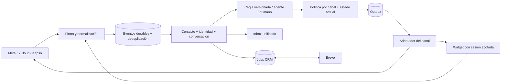

# Omnichannel Pixiweb — Master Blueprint Forge

**Versión:** 1.0 · **Fecha:** 2026-10-10 · **Estado:** APROBADO POR YANI — BUILD MANUAL  
**Base:** app-whatsapp-saas-conectado, commit `28a1530`  
**Autorización:** Yani aprobó el blueprint y pidió comenzar el 2026-10-10. Build Manual elegido por Yani; F1 en preparación. Cada fase o etapa importante se desarrolla en una rama distinta de main.  
**Plan:** 9 fases, 27 historias, 72 tareas, 18 templates de pantalla.  
**Estimación inicial:** 45–69 días-persona de desarrollo (9–14 semanas laborales con una persona dedicada); no plazo comprometido. Excluye esperas por accesos/App Review, entrevistas, soporte operativo y contingencias aún no dimensionadas.

## 1. Visión y decisiones

Ampliar el SaaS funcional de agentes de WhatsApp a una mensajería centralizada para WhatsApp, Instagram, Facebook Messenger y chat web. La persona del negocio atiende en una bandeja, automatiza una guía solicitada por comentario y conserva contexto de ventas en Brevo. Cada cliente conecta sus propias cuentas Meta. El diseño se adapta al sitio **actual de Pixiweb**, observado en vivo.

Decisiones confirmadas por Yani: excluir TikTok; Instagram DM y comentario→guía; Facebook; widget propio; Brevo contactos/listas/oportunidades **bidireccionales**; autoservicio de conexiones por cliente; rediseño Pixiweb. La captura es referencia funcional, no una instrucción para copiar cada módulo del menú.

Decisiones del blueprint aprobado: Facebook Login for Business con Página e IG profesional vinculado; un CRM activo por workspace; API key Brevo cifrada por cliente; ampliar el modelo de identidades y mantener proveedores/motor del fork. No instalar Chatfuel como dependencia. No reescribir el producto desde cero.

**Viabilidad:** técnicamente viable con condiciones de proveedor. La base se reporta funcional por Yani; esta etapa la inspeccionó estáticamente, no probó su producción. App Review, capacidades de fuentes ampliadas y cuotas de cada cuenta deben demostrarse antes de ofrecerlas. Viabilidad comercial, precio, margen, volumen y SLA siguen sin datos suficientes.

**Negocio y valor (hipótesis):** negocios con atención fragmentada y agencias que operan varios workspaces. Beneficio buscado: continuidad de conversación y captación con menos tareas repetidas; no se inventa ahorro porcentual. Suscripción SaaS existente, límites/planes por definir; no se agrega billing. Costos relevantes: hosting/DB, proveedores WhatsApp, IA, operación y soporte de integraciones.

**Roles:** admin configura activos; manager administra reglas con permiso; agent atiende y edita campos autorizados; viewer lee; administradora de agencia cambia entre workspaces autorizados. No reemplazar auth/roles.

### Alcance de entrega

- **R1 núcleo:** base WA conservada, identidades sin teléfono, diseño completo, conexión Meta, IG DM/posts/Reels, Messenger DM/posts, widget, inbox, reglas/probador y Brevo bidireccional.
- **R2 expansión incluida:** historias, enlaces ig.me/m.me, comentarios en anuncios IG, anuncios a Instagram/Messenger/WhatsApp y entradas desde publicaciones hacia WhatsApp. Activación condicionada a API/permisos/payloads verificables.
- **Fuera:** TikTok, perfiles personales/grupos FB, Instagram Live, builder libre de nodos, email marketing, Brevo Conversations, compra/optimización de anuncios, difusión social irrestricta, nuevo billing, calendario/Kanban completos y migración de historial de Chatfuel.

### Primer recorrido de éxito

Admin conecta Página/IG → manager elige publicación y keyword hola → configura texto con su URL HTTPS → simula → activa → comentario válido reserva una private reply → destinatario recibe una guía → responde y habilita seguimiento → operador/IA atiende → contacto/lista/oportunidad sincronizan con Brevo. Si la persona no responde, no se inicia una secuencia de DMs.

El acceso a la guía no se inventa; lo configura cada cliente. Un problema CRM no bloquea el chat; un timeout remoto no dispara un reenvío ciego.

### UX de referencia

Personas provisionales: operadora, administrador cliente, administradora de agencia y visitante. Derivadas del pedido y del producto, no de entrevistas realizadas. Modelos clave: persona ≠ identidad ≠ conversación; conectado ≠ listo; comentario ≠ ventana abierta; guardado local ≠ confirmado en CRM. Validar con tareas de usuarios durante piloto.

Navegación: Inicio, Chats, Automatizaciones y Configuración; conservar Analisis/Agencia. Contactos y oportunidades se operan inicialmente desde ficha/vistas CRM asociadas. Workspace/canal/cuenta siempre visibles. Nuevas pantallas usan la navegación existente antes de multiplicar rutas.

## Las 14 fuentes de la captura, sin TikTok

R1 = núcleo omnicanal; R2 = expansión de fuentes de entrada. R2 sigue dentro del alcance del blueprint.

| ID | Canal / fuente | Requisito funcional | Mecanismo y límite | Entrega |
|---|---|---|---|---|
| IG-01 | Mensajes directos | Responder con IA o humano; bandeja y contexto compartidos | Messaging API, eventos de mensajes; cuenta profesional y ventana aplicable [M1,M3] | R1 |
| IG-02 | Publicaciones y Reels | Elegir post, palabra clave y guía; respuesta privada; respuesta pública opcional | Webhook `comments`, private reply por `comment_id`; una respuesta inicial, hasta 7 días; seguimiento tras respuesta del destinatario [M2] | R1 |
| IG-03 | Historias | Automatizar respuestas, menciones y comentarios cuando el evento esté disponible | Separar DM de respuesta a historia, mención y comentario público; no asumir un webhook idéntico ni tratar visualizaciones como mensajes [M1,M2]; validar payloads por variante | R2 |
| IG-04 | Anuncios en publicaciones | Disparar desde comentario elegible en anuncio | No es lo mismo que clic a mensaje; permisos/activos publicitarios y acceso al comentario deben probarse [M2,M4] | R2 condicionado |
| IG-05 | Enlace IG.me | Abrir conversación y conservar origen si Meta lo entrega | Entrada por enlace; no prometer que cada clic entregue un evento ni habilite mensaje; fallback a mensaje entrante sin atribución | R2 condicionado |
| IG-06 | Anuncios que dirigen a Instagram | Regla por origen publicitario de conversación | Mensaje/postback/referral recibido; no actuar por impresión o clic sin evento habilitante. Requiere prueba del payload vigente | R2 condicionado |
| FB-01 | Mensajes entrantes | Inbox de Messenger de Páginas, IA y humano | Send API + webhooks, token de Página y permisos de mensajería [M3,M5] | R1 |
| FB-02 | Publicaciones | Comentario con keyword → mensaje privado y respuesta pública opcional | Private Replies de Página; una respuesta inicial hasta 7 días; seguir conversando solo luego de respuesta [M5] | R1 |
| FB-03 | Enlace m.me | Abrir Messenger y clasificar referencia disponible | `ref`/postback/referral cuando existan; un clic aislado no se toma como consentimiento universal | R2 condicionado |
| FB-04 | Anuncios a Messenger | Enrutar conversación según anuncio de origen | Usar metadata efectivamente recibida. No incluye crear/comprar/optimizar anuncios | R2 condicionado |
| WA-01 | Mensajes entrantes | Mantener lo existente y mostrarlo junto a otros canales | Adaptador hacia YCloud/Kapso; preservar plantillas, opt-out, buffer y coexistencia | R1 regresión |
| WA-02 | Click-to-WhatsApp Ads | Conservar origen y ejecutar regla tras mensaje entrante | Parsear referral de proveedor cuando esté presente; evidenciar con fixtures y cuenta real [M6] | R2 |
| WA-03 | Publicaciones Click-to-WhatsApp | Distinguir mensajes originados desde una publicación/enlace | No hay equivalencia automática con comentario→DM de IG. Enlace/texto prellenado puede orientar; atribución puede faltar | R2 condicionado |
| WEB-01 | Chats del sitio web | Widget embebible con IA, humano y persistencia | Canal propio, loader + iframe y sesión de visitante; mismo inbox; no depende de Messenger ni Brevo Conversations | R1 |

Las filas condicionadas deben mostrar «Disponible al validar esta fuente» hasta aprobar una prueba real. No presentar como «Activado» una capacidad cuya recepción no fue comprobada.


## 2. Arquitectura y contrato de datos

Versión 1.0 · 2026-10-10 · **Diseño propuesto; ninguna migración aplicada**.

### Base y decisiones de arquitectura

Fork en commit `28a1530`. Conservar Next.js 16, React 19, TypeScript 5.7, Tailwind 3.4, shadcn/Radix, Supabase Auth/Postgres/Storage, Zod 4, Zustand 5 y AI SDK **6**. Las versiones exactas se toman del lockfile al construir; no instalar `latest` ni bajar AI SDK a v5 por la plantilla Forge.

El hosting del entorno operativo no fue comprobado. Mantener el despliegue compatible con Next actual. Usar primero el mecanismo existente de workers HTTP + pg_cron/pg_net con jobs persistidos; no incorporar Redis, microservicios ni un nuevo scheduler de pago como prerrequisito.

#### Módulos propuestos

| Módulo | Responsabilidad |
|---|---|
| `src/features/channels/` | Conexiones, capacidades, política de envío, interfaces/adaptadores WA/Meta/Web |
| `src/features/contacts/` | Identidades por cuenta, vinculación verificada y preferencias |
| `src/features/inbox/` | Timeline, estados, buffer/agente, handoff y despacho compartidos |
| `src/features/automations/` | Editor, condiciones, versiones, pasos, simulación y ejecución |
| `src/features/crm/` | Interfaz CRM, Brevo, mapeos y conciliación; mantener contratos de HighLevel/HubSpot |
| `src/features/widget/` | Configuración, iframe, sesión visitante y endpoints acotados |
| `src/features/settings/` | UI de canales/CRM y permisos |
| `src/shared/` | Tokens/componentes, autorización y utilidades realmente comunes |

No mover todo el código existente al inicio. Extraer puntos de extensión con pruebas de regresión; mantener archivos nuevos debajo de 500 líneas y funciones pequeñas.

#### Flujo de datos



### Contratos internos

**InboundEvent:** workspace resuelto en servidor, connectionId, providerEventId, kind, occurredAt, receivedAt, externalActorId, externalMessageId/commentId, content, mediaRefs y sourceContext permitido. El body remoto nunca elige el tenant. Conservar solo el payload mínimo y una copia diagnóstica protegida con retención.

**SourceContext:** channel, sourceType, assetId/postId/storyId/adId, referralRef y evidenceEventId opcionales. No deducir origen publicitario si el proveedor no lo entregó. Datos de campaña son contexto, no instrucciones para la IA.

**ChannelAdapter:** normalizeInbound, sendText, sendMedia, sendPrivateReply, replyPublicComment, fetchHistory y reconcileSend como capacidades opcionales explícitas. Resultado: accepted/externalId, rejected/errorCode o unknown. Un adapter no puede declarar una capacidad sin prueba de integración.

**SendPolicy:** recibe canal/cuenta, actor humano o automático, estado/revisión de conversación, mensaje/evento habilitante, consentimiento, capacidades y hora del servidor; devuelve allow/deny, reasonCode, validUntil y evidencia. Se evalúa al crear el job y otra vez inmediatamente antes del envío.

**CRMAdapter:** testConnection, upsertContact, listLists, create/updateList, add/removeMembership, listPipelines, create/updateDeal, associateContact, fetchChanges y reconcile. No asumir que todas las implementaciones pueden hacer todo. Mantener los contratos existentes hasta migrarlos.

### Modelo de datos y restricciones

Diccionario contractual para diseñar migraciones del fork, no SQL para ejecutar directamente sobre producción. Toda tabla pública de tenant lleva `workspace_id uuid NOT NULL`, `id uuid`, timestamps UTC, RLS y unicidad compuesta `(workspace_id,id)` si otra tabla la referencia. FKs entre entidades incluyen workspace para impedir mezclas incluso desde un worker privilegiado. Campos JSON contienen datos validados/versionados, nunca secretos públicos.

| Tabla | Columnas nuevas/principales y claves |
|---|---|
| `contacts` existente | Permitir `phone text NULL`; mantener normalización y unicidad del teléfono no nulo por workspace; nombre/email opcionales, preferencias actuales intactas. Añadir revisión optimista si no existe |
| `channel_connections` | channel enum WA/IG/Messenger/Web, provider text, external_account_id text, display_name, status, capabilities jsonb, settings jsonb, credentials_ref uuid, last_verified_at, revoked_at. Unique workspace/channel/provider/account; índice de routing global de activo con exclusividad de tenant activo |
| `private.channel_credentials` | connection_id uuid, workspace_id, encrypted_payload text, key_version, expires_at. Sin acceso anon/authenticated, sin Realtime; cifrado con AAD workspace+provider+connection |
| `contact_identities` | contact_id uuid, connection_id uuid, external_user_id text, kind, verified_at, metadata mínima. Unique workspace/connection/external_user_id; no unique global por username |
| `conversations` existente | connection_id uuid, identity_id uuid, channel enum ampliado, state_revision bigint, source_context jsonb, last_eligible_inbound_at, policy_context jsonb. Unique workspace/connection/identity para conversación persistente; mantener IDs/historial y estados actuales |
| `messages` existente | connection_id, external_message_id text, provider text, delivery_state, policy_evidence jsonb, operation_id uuid. Unique workspace/connection/external_message_id donde no nulo; conservar wamid durante transición |
| `channel_events` | connection_id, event_key text, event_kind, occurred_at, received_at, payload_min jsonb, processing_status, expires_at. Unique workspace/connection/event_key; índice de pendientes/retención |
| `social_comments` | connection_id, external_comment_id, external_actor_id, media_id, media_kind, text mínimo, occurred_at, eligibility_until. Unique workspace/connection/external_comment_id |
| `private_reply_claims` | connection_id, external_comment_id, automation_run_id, message_operation_id, status, claimed_at. Unique workspace/connection/external_comment_id; las reglas compiten por esta reserva, no envían cada una |
| `message_jobs` | operation_id unique, connection_id, conversation_id opcional para primer private reply, event_id, action, payload, state, expected_state_revision, run_after, attempts, lease_owner, lease_until, result_external_id, last_error_code. Unique idempotency_key; índice state/run_after |
| `automation_rules` existente | scope canal/cuenta/fuente, priority, status, active_version_id; conservar compatibilidad de reglas v1 y permisos |
| `automation_rule_versions` | rule_id, version int, condition_schema_version, conditions jsonb, steps jsonb, created_by. Unique workspace/rule/version; versiones publicadas inmutables |
| `automation_runs` existente/ampliada | rule_version_id, event_id, conversation_id nullable, state, matched_reason, step_results, policy_result, started_at, finished_at. Unique workspace/rule_version/event |
| `widget_sites` | connection_id, public_site_id aleatorio unique, allowed_origins text[], public_config jsonb, enabled, retention_days; no credenciales CRM ni datos de contactos |
| `widget_sessions` | site_id, identity_id, conversation_id, token_hash, expires_at, revoked_at, verified_subject opcional. Revocación efectiva; token sin datos personales |
| `crm_connections` | integración existente o referencia equivalente, workspace, provider, account_fingerprint, active, status, config sin secretos. Un solo CRM activo por workspace |
| `crm_links` | crm_connection_id, entity_type, local_entity_id, remote_id, remote_version, last_common_hash, last_synced_at, tombstoned_at. Unique conexión/tipo/local y conexión/tipo/remote |
| `crm_lists` + `crm_memberships` | catálogo local: nombre, remote_list_id, managed; relación contacto/lista unique, origen y revisión. El catálogo mapeado es distinto de etiquetas arbitrarias |
| `crm_deals` | crm_connection_id, remote_deal_id, contact_id, name, pipeline_id, stage_id, amount numeric nullable, currency text nullable, attributes jsonb, revision. Índices de pipeline/contacto; importe cero distinto de desconocido |
| `crm_sync_jobs` | direction, entity_type, entity_id, operation_id, origin, expected_revision, payload_hash, state, retry_at, attempts, lease_until, error_code. Índice de vencidos; estados unknown/conflict |
| `crm_sync_conflicts` | entity/link, base snapshot/hash, cambios local/remoto, fields, resolved_by, resolution, resolved_at. Solo roles habilitados resuelven |
| `integration_audit_events` | actor, connection, action, outcome, correlation_id, timestamp, datos mínimos sin token/body completo |

Entidades auxiliares (listas, oportunidades, conflicto) son necesarias para mostrar y editar los objetos bidireccionales; no crean un CRM comercial adicional ni un Kanban.

**Aislamiento:** canal/activo activo pertenece a un solo workspace por app/proveedor. Un operador de agencia cambia de workspace; no duplica una misma Página en dos tenants. Transferir activo es una operación administrativa explícita con pausa y auditoría. Filtros de UI no reemplazan RLS.

**Identidad:** persona y conversación son distintas. Puede haber varias conversaciones de una persona en distintos canales/cuentas. Vinculación solo con prueba o decisión autorizada dentro del workspace. Sin email/teléfono no inventar valores. Borrar o desvincular no expone mensajes de otra identidad.

#### Migración expandir → migrar → activar

1. Capturar baseline, backup restaurable y conteos/hash de conversaciones/mensajes, en entorno aislado. Inventariar TODAS las migraciones actuales; la guarda vigente está en `20260927000001_whatsapp_provider_per_workspace.sql`.
2. Crear tablas/columnas aditivas/RLS con flags apagados; ampliar enum en transacción separada si Postgres requiere commit antes de usar valores.
3. Crear conexiones WA desde integraciones activas. Backfill identities desde phone normalizado y conexiones; preservar IDs de conversación, wamid y relaciones. Detectar colisiones/múltiples proveedores antes de cambiar unicidad.
4. Rellenar connection_id/identity_id en lotes reanudables; validar conteos y FKs. Índices únicos primero con reporte de colisiones, nunca borrar duplicados para que pase.
5. Adaptar lectores/escritores WA, dual-read transitorio donde haga falta, cubrir coexistencia/ecos, template guard, notas y supresiones.
6. Reemplazar guardas de envío por política de canal, retirar unicidad antigua solo cuando los nuevos escritores estén activos. Permitir phone nulo después de actualizar todas las validaciones/formularios.
7. Activar nuevo canal por workspace. Rollback operativo: apagar entradas/reglas/envíos de ese canal y seguir WA, conservar tablas e historial. No deshacer migraciones destruyendo datos nuevos.

Nombres reservados para futuras migraciones (a crear y validar en /build): `20261010000001_omnichannel_expand.sql`, `20261010000002_omnichannel_backfill.sql`, `20261010000003_omnichannel_constraints.sql`, `20261010000004_automation_jobs.sql`, `20261010000005_widget_sessions.sql`, `20261010000006_brevo_sync.sql`. Verificar conflictos de timestamps al construir. No existen por haberlas nombrado aquí.

### Meta: onboarding y envío

Una app del SaaS, Facebook Login for Business por cliente, Página + Instagram Business/Creator vinculado. No cuentas personales. IG Login sin Página es alternativa futura; no mezclar scopes. Fijar versión Graph desde el App Dashboard en F1; no inventar versión en este documento.

Scopes candidatos: pages_show_list, pages_manage_metadata, pages_messaging, pages_read_engagement, instagram_basic, instagram_manage_messages, instagram_manage_comments. Evaluar pages_read_user_content/pages_manage_engagement para comentarios y respuestas públicas. Solo agregar ads_read/ads_management donde el endpoint/rol realmente lo exija.

OAuth state de un solo uso, TTL, ligado a usuario/workspace/rol y redirect registrado; callback vuelve a comprobar rol. Mostrar selector de activos y permisos, suscribir cada activo después de validar titularidad, persistir cifrado y probar recepción. `connected` no equivale a `ready`: estados connecting, needs_permissions, awaiting_webhook, ready, degraded, revoked.

Webhook: challenge con verify token del servidor; POST con firma HMAC SHA-256 sobre bytes originales usando app secret, comparación constante. Resolver connection desde activo, validar esquema/tamaño y guardar evento duradero antes de ACK. Evento desconocido se registra sin ejecutar acciones.

| Caso | Política |
|---|---|
| WA | Adaptador mantiene proveedor activo, ventanas, templates/opt-in y supresión actuales; no crear excepción nueva por rediseño |
| IG/Messenger DM habitual | Respuesta dentro de ventana estándar aplicable, normalmente 24h desde inbound habilitante; comentario público no la abre |
| IG/Messenger private reply | Una respuesta inicial por comentario elegible, hasta 7 días según endpoint; validar FB vigente en spike; Live fuera |
| Seguimiento de private reply | Solo luego de respuesta del destinatario que habilita mensajería; el primer private reply no dispara secuencia ni agente |
| Anuncio Click-to-Instagram Direct | Documentación IG actual describe hasta 7 días para primera interacción elegible; flag apagado hasta probar criterios/payload/version; registrar evidencia y validUntil |
| Human Agent | Extensión solo si acceso vigente y envío manual humano; nunca usar para IA o automatización |
| Web | Sin ventana Meta; sujeto a sesión, preferencias, abuso y estado humano/IA propios |

Errores no sorteables: expiry, revoked, permission_missing, identity_unknown, opted_out, human_hold, duplicate_private_reply, unsupported_capability. Un admin no puede forzar una prohibición de Meta. Los media/CDN URLs pueden expirar; validar permisos y renovar referencias, no suponer permanencia del enlace. Descargas solo desde hosts autorizados, sin URLs privadas/loopback ni HTML activo.

### Automatizaciones y fiabilidad

Editor de reglas con canal → cuenta → fuente → activo/post → palabra/condiciones → pasos → prueba → activar. Mantener v1; traducir sus triggers/acciones conservando semántica. No habilitar triggers históricos que el código no ejecuta.

Keywords: NFKC, trim, casefold; opción explícita de equivalencia de tildes; palabras completas o frase según selección; sin regex arbitraria inicial. Excluir comentarios propios, borrados/no elegibles y eventos históricos importados. Una regla ganadora por prioridad determinista; si hay empate, orden estable visible.

Pasos iniciales: private reply, respuesta pública opcional, etiqueta, asignación, handoff y operación CRM. Send text solo para evento/canal habilitante. Registrar éxito/error por paso: una falla CRM no repite un DM entregado. Draft, active, paused y archived con versiones; pausar cancela jobs pendientes, no mensajes ya enviados.

Jobs con dedup única, adquisición transaccional (`FOR UPDATE SKIP LOCKED`), lease y fencing/revisión de conversación. El humano toma conversación → invalida trabajo IA pendiente. Revalidar luego de generar texto y antes de enviar. Webhook duplicado, eco outbound o receipt no invocan de nuevo la IA.

No se garantiza exactly-once entre DB y proveedor remoto. Timeout/crash después del POST puede ser envío confirmado remotamente: marcar unknown, intentar correlacionar por ID/eco/capacidad documentada; si no se puede, revisión manual. Nunca reenviar a ciegas una guía o crear otra oportunidad.

ACK después de persistir; dispatch inmediato acotado con jobs durables y recuperación por cron. No usar tareas fire-and-forget después de devolver HTTP. Con solo cron cada minuto no prometer entrega en segundos. Backoff exponencial+jitter, Retry-After, cuotas por app/cuenta/tenant, DLQ y límite de intentos/edad. Historial importado se marca histórico y no ejecuta reglas.

### Brevo bidireccional

API key por workspace con privilegios mínimos disponibles y cifrado; autenticación pública OAuth multi-cliente no se asume disponible: la documentación vigente describe apps privadas. Probar `GET /v3/account`, detectar cuenta ya conectada y mapearla. Cambio de cuenta invalida jobs/mapeos viejos, no reasigna sus IDs a la cuenta nueva.

- Contactos: stable ext_id namespace workspace+contact; GET/lookup y crm_link antes de crear. Preferir update id conocido; no usar forceMerge. email/SMS solo reales. Atributos deben existir; validar tipos y nombre uppercase cuando lo exija Brevo.
- Listas: importar catálogo y seleccionar listas administradas; crear/renombrar desde SaaS es acción explícita. Membresías se agregan/quitan por deltas, sin reemplazar listas ajenas. Eventos no cubiertos → reconciliar catálogo y miembros paginados.
- Oportunidades: catálogo de pipelines/etapas remoto, asociación a contactos vía IDs; importe/moneda opcionales reales. Crear una vez por operación; cambios locales/externos reflejados. No usar el nombre como identidad ni asumir unicidad.
- Webhooks: contactos/listas usando autenticación/headers soportados; Sales CRM posee guía propia, verificar alta disponible en la cuenta. No enviar un inventado `type:sales` al endpoint genérico.
- Cuando no haya webhook de un cambio, reconciliación eventual y visible. Presupuesto por familia de endpoint, caché de catálogos, cursores y polling adaptativo; el límite general de otros endpoints puede ser 100/h.
- Imports iniciales: listas y pipeline seleccionados, previsualización de alcance; no copiar automáticamente toda la base de un cliente. Reconciliar las entidades administradas y explicitar cobertura.

| Campo/operación | Autoridad y conflictos |
|---|---|
| ID local / identidad de canal | SaaS; Brevo nunca cambia la pertenencia tenant/canal |
| Nombre, email, teléfono, atributos mapeados | Merge de campos distintos desde último snapshot común; mismo campo cambiado en ambos → conflicto visible, sin decidir por reloj remoto |
| Preferencias/supresión | Prevalece la opción más restrictiva; consentimiento y evidencia por canal, no equivalencia email=WA |
| Pipeline/etapa, importe/moneda | Catálogo Brevo; cambios explícitos de cualquier lado pasan por revisión/base común y conflicto si simultáneos |
| Lista/membresía administrada | Cambios bidireccionales por revisión/delta; eliminación concurrente conserva baja hasta resolución |
| Eliminación | Tombstone + detener sync; no recrear ni borrar automáticamente todo el historial remoto/local |

Prevención de loops: origin + operation_id + base revision/hash; un eco de nuestros cambios actualiza confirmación, no inicia nueva operación. No depender de que Brevo preserve headers de idempotencia no documentados.

Crashes de creación de deal: correlacionar mediante mapeo y marcador externo si la cuenta admite atributo dedicado; validar esto en F1. Sin identificador recuperable, unknown/revisión antes de cualquier retry. Webhook es señal, recuperar estado remoto autenticado para verificar datos sensibles; payloads grandes y replays se deduplican.

### Widget y API de aplicación

Loader versionado monta iframe del SaaS con sitio público; no inyecta scripts de terceros. Allowlist de orígenes exactos (scheme/host/port), CSP frame-ancestors, CORS sin wildcard y postMessage validando origin/source/esquema. La allowlist del navegador no autentica a un atacante de servidor: añadir cuotas, TTL y protección de abuso.

Visitante anónimo con token aleatorio/firmado limitado a site/session/conversation y revocable. Persistencia primera parte a través del loader y protocolo acotado; no depender de cookies de terceros. Token en memoria/almacenamiento minimizado, nunca URL/log. No recuperar mensajes históricos por email ingresado. Verificación posterior no mezcla conversaciones sin autorización.

Visitante accede únicamente por gateway server-side; no suscripción general a Realtime ni service-role en cliente. Entrega SSE cuando el hosting lo permita, con fallback polling mediante cursor y token acotado. Operadores conservan Realtime bajo RLS. Sanitizar texto/links, tamaño máximo y adjuntos con capability off hasta validación.

| Endpoint propuesto | Autorización/contrato |
|---|---|
| `/api/workspace/[id]/channels` GET/POST/PATCH | Sesión+membership; admin configura; manager si permiso explícito; schema Zod y secreto write-only |
| `/api/integrations/meta/start`, `callback` | Sesión/state/rol; selección de activos; no workspace confiado desde query |
| `/api/webhooks/meta` GET/POST | Challenge/firma; activo resuelto por servidor |
| `/api/webhooks/brevo/[connectionToken]` POST | Identificador opaco distinto del secreto + auth configurada; leer estado remoto; no tenant en body |
| `/api/widget/bootstrap`, `messages`, `events` | site + origen + sesión; enviar/leer solo conversación propia; límites por sitio/sesión |
| `/api/conversations/[id]/messages` existente | Sesión+workspace+rol y política de canal; idempotencyKey requerido |
| `/api/workspace/[id]/automations/simulate` | Sin efectos externos; fixture/snapshot, salida de pasos y política |
| `/api/workspace/[id]/crm/sync`, `conflicts` | Roles explícitos; retry no crea duplicados; resolver con expectedRevision |
| `/api/internal/channels/process`, `crm/process` | Secreto interno server-only, lotes acotados y lease; nunca endpoint público sin auth |

Roles: admin conecta/desconecta y gestiona permisos; manager configura reglas y CRM según grants del workspace; agent responde/toma/asigna dentro de permisos actuales y puede editar campos autorizados; viewer solo lectura. Toda mutación vuelve a validar, no depende de esconder botones. Operaciones de CRM con impacto quedan auditadas.

#### Configuración propuesta (nombres, nunca valores)

`META_APP_ID`, `META_APP_SECRET`, `META_WEBHOOK_VERIFY_TOKEN`, `META_GRAPH_API_VERSION`, `META_REDIRECT_URI`, `WIDGET_SIGNING_SECRET`, `WIDGET_PUBLIC_BASE_URL`. Reutilizar las variables vigentes de URL/Supabase/cifrado/cron después de inventariar `.env.local.example`; no duplicar claves de cifrado. Brevo api-key y secreto webhook son POR WORKSPACE cifrados, no una única `NEXT_PUBLIC_BREVO_KEY`. No variable secreta con NEXT_PUBLIC.

Servicios: Meta, YCloud/Kapso existentes, Brevo del cliente, Supabase, hosting y modelo IA existentes. Costos dependen de planes/volumen; no se verificaron facturas, cuotas comerciales ni un presupuesto. No habilitar facturación.

### Validación, observabilidad y operación

Pruebas de contrato con fixtures oficiales anonimizados; unit tests de políticas/dedup/conflictos; migración en copia con dos tenants; E2E de operador/visitante; sandbox real Meta/Brevo para cada capacidad publicada. Simulador y mocks no prueban aprobación ni delivery real.

Medir ACK p95, edad de job más viejo, respuesta permitida/bloqueada/unknown, fallas y cuota por conexión, lag CRM, conflictos, handoffs, consumo IA y reconexiones. IDs de correlación en UI/log; no guardar secretos/texto completo por defecto.

Objetivos técnicos de piloto propuestos, a medir: ACK duradero p95 <2s bajo carga acordada; cero cruces de tenant; cero reenvíos automáticos tras unknown; jobs recuperables ante reinicio; lag CRM dentro del presupuesto configurado. Latencia de keyword y concurrencia se fijan con el spike/carga real; no se ofrece SLA comercial.

Revocación desconecta cuenta, cancela jobs futuros y mantiene historial conforme retención; atención por otros canales sigue. Callback de eliminación y procesos de exportación/borrado se revisan con políticas del producto antes del lanzamiento. URLs de privacidad y condiciones deben pertenecer al SaaS; el rediseño no copia promesas legales/comerciales de Pixiweb.

Fuentes y límites vigentes: [relevamiento](docs/investigacion/RELEVAMIENTO-omnichannel-pixiweb.md). Fijar contratos/versiones en F1 antes de implementar contra un proveedor.


## 3. Secuencia y estimaciones

Cada fase termina con incremento demostrable. Los controles de aislamiento, autorización, privacidad y regresión son obligatorios durante todo el trabajo; F9 reúne la evidencia final. Para publicar solo R1 primero, ejecutar el gate de calidad aplicable de F9 al cerrar F7; F8 permanece en el backlog comprometido hasta resolver sus capacidades.

| Fase | Días-persona | Historias | Templates nuevos/rediseñados | Entregable |
|---|---:|---|---|---|
| F1 Base compatible y contratos comprobables | 5–8 | US-001, US-002, US-003 | Reutiliza S08–S11 | App local con login/WA base operables, reporte de migración en copia y matriz de capacidades/pendientes. |
| F2 Sistema Pixiweb y rediseño transversal | 4–7 | US-004, US-005 | S01, S02, S03, S04, S05, S06, S07 | App existente rediseñada, responsive, con showcase de componentes. |
| F3 Motor de canales e inbox unificado | 5–8 | US-006, US-007, US-008 | S08 | WhatsApp usa la interfaz de canal; inbox reconoce múltiples cuentas con fixtures y envíos protegidos. |
| F4 Instagram, conexión Meta y reglas comentario→guía | 7–10 | US-009, US-010, US-011, US-012 | S09, S10, S11 | Cliente conecta Página/IG; DM y comentario elegible → una guía funcionan con prueba y trazabilidad. |
| F5 Messenger y comentarios de Facebook | 4–6 | US-013, US-014 | Reutiliza S08–S11 | Página de Facebook opera DM y private reply en el mismo inbox/editor. |
| F6 Widget de chat propio | 4–6 | US-015, US-016 | S12, S13 | Snippet embebido en sitio de prueba con chat visitante, IA/humano y sesión privada. |
| F7 Brevo CRM bidireccional | 7–10 | US-017, US-018, US-019, US-020, US-021 | S14, S15, S16 | Contactos, listas y oportunidades convergen en ambos sentidos, con conflictos y cuotas visibles. |
| F8 Historias, enlaces y fuentes publicitarias | 5–8 | US-022, US-023, US-024, US-025 | S17 | Matriz de 14 fuentes con capacidades reales y reglas habilitadas solo para variantes probadas. |
| F9 Validación integral y preparación de lanzamiento | 4–6 | US-026, US-027 | S18 | Paquete de evidencia, operación/rollback, diagnóstico y candidato local/staging listo para decisión de lanzamiento. |

Dependencia propuesta secuencial: F1 → F2 → F3 → F4 → F5 → F6 → F7 → F8 → F9. No se exige equipo paralelo. Las cuentas externas y App Review pueden avanzar durante desarrollo sin confundir preparación con aprobación.

### Comandos para el futuro /build

No se ejecutaron en la planificación. Usar un checkout aislado si la implementación lo requiere y preservar los untracked de Forge. Revisar Node compatible con tests del fork (22.18+), lockfile y variables de `.env.local.example` sin imprimir secretos. No usar 3300 ni 3301 ni detener sus procesos.

```powershell
Set-Location -LiteralPath 'C:\Users\Yani Acevedo\Documents\GitHub\apps\app-whatsapp-saas-conectado'
git status --short
node --version
npm ci
npm run typecheck
npm run lint
npm run test:unit
Get-NetTCPConnection -LocalPort 3100 -ErrorAction SilentlyContinue
```

Si 3100 está libre, iniciar con `npm run dev -- --port 3100`; si está ocupado, elegir otro puerto no reservado sin terminar procesos ajenos. Crear/configurar la suite Playwright de esta ampliación antes de ejecutar `npm run test:e2e`: existe script/dependencia, pero no se encontró configuración/suite E2E en el inventario actual. Ejecutar `npm run build` al cierre de cambios pertinentes, no por cada tarea documental.

Las migraciones requieren copia de prueba, plan de backfill y revisión. No incluir `db reset` ni `db push` sobre remoto como comando de arranque.

## FASE 1 — Base compatible y contratos comprobables

**Estado:** EN_PROGRESO — BUILD MANUAL · **Duración:** 5–8 días-persona · **Depende de:** Ninguna fase nueva; parte del fork existente.

**Entregable:** App local con login/WA base operables, reporte de migración en copia y matriz de capacidades/pendientes.

**Responsable propuesto:** una persona de desarrollo, con revisión de producto por Yani; acceso de administrador del proveedor cuando corresponda.

### Historias y criterios de esta fase

### US-001 — Preservar el SaaS operativo

**Prioridad:** P0 · **Fase:** F1

Como administradora quiero conservar WhatsApp, roles, agentes y datos para ampliar el producto sin perder atención.

- AC1: Con una copia de la base, el backfill conserva IDs y conteos de contactos/conversaciones/mensajes WA y produce reporte de colisiones.
- AC2: YCloud y Kapso superan los contratos vigentes, incluyendo templates, ecos, supresión y handoff.
- AC3: Se puede desactivar el nuevo canal y seguir atendiendo WhatsApp sin borrar historial.

### US-002 — Contactos e identidades sin teléfono

**Prioridad:** P0 · **Fase:** F1

Como operadora quiero atender a una persona de Instagram aunque no tenga teléfono.

- AC1: Crear contacto con phone nulo funciona en backend, UI y exportaciones aplicables; no se inventa email/phone.
- AC2: Dos IDs iguales de cuentas distintas no se mezclan; FKs/RLS bloquean relaciones entre workspaces.
- AC3: La conversación conserva connection_id e identidad; reconectar la misma cuenta no duplica identidades.

### US-003 — Verificar contratos externos

**Prioridad:** P0 · **Fase:** F1

Como administradora quiero saber qué capacidades están realmente habilitadas antes de ofrecerlas.

- AC1: Registrar versión Graph, scopes, activos de prueba y fixtures anonimizados para DM/comentario IG/FB.
- AC2: Registrar resultado de prueba Brevo de ext_id, listas, pipeline/deal, webhooks Sales y recuperación de un create ambiguo.
- AC3: Distinguir soporte documental, prueba sandbox, acceso avanzado y habilitación productiva; una falta de credenciales queda pendiente, no exitosa.

### 1.1 Capturar baseline y contratos

- [x] **F1-T1.1** Inventariar scripts, migraciones, permisos y estado Git; guardar baseline de tests y rutas existentes sin incluir secretos. Evidencia local: [F1 baseline](docs/F1-BASELINE-omnichannel.md); permisos Cloud todavía no comprobados.
- [ ] **F1-T1.2** Crear fixtures anonimizados de YCloud/Kapso y escenarios de regresión de templates, ecos, handoff y CRM actual.
- [ ] **F1-T1.3** Preparar reporte de versión Graph/scopes/cuentas Meta y ensayar DM/comentario con cuentas de prueba autorizadas; documentar accesos faltantes.
- [ ] **F1-T1.4** Ensayar Brevo ext_id, listas, pipelines/deal y método de webhook Sales; verificar cuotas y recuperación de create ambiguo.

### 1.2 Expandir identidad y datos

- [ ] **F1-T2.1** Diseñar/aplicar en copia la migración aditiva de channel_connections/credenciales y RLS, con flags apagados.
- [ ] **F1-T2.2** Implementar contacts.phone opcional y contact_identities con FKs compuestas/índices; actualizar validadores de contacto.
- [ ] **F1-T2.3** Crear backfill reanudable de WA/conversations/messages con reporte de colisiones; conservar IDs y wamid.
- [ ] **F1-T2.4** Validar conteos, aislamiento entre dos tenants, reconexión y rollback por flags antes del cambio de unicidad.

**Archivos/módulos a intervenir:** supabase/migrations/ (archivos futuros enumerados en el schema); src/features/channels/types/; src/features/contacts/; src/features/inbox/types/.

### Wireframes y prompts de la fase

Sin pantallas nuevas: demostrar login/dashboard/inbox existentes con la copia de prueba. Sus variantes visuales se planifican en F2.

### Aceptación y demostración

- [ ] Cumplir todos los AC de US-001, US-002, US-003 con evidencia enlazada en La Pieza de /build.
- [ ] Completar pruebas de seguridad/regresión pertinentes del plan QA; ningún cambio de esta fase rompe WA ni aislamiento.
- [ ] Registrar pendientes externos y mantener apagadas capacidades no probadas.
- [ ] Demostrar en cinco minutos: Abrir el SaaS existente, autenticar, mostrar chat WA y un contacto de prueba sin teléfono; adjuntar reporte de backfill.

**Notas técnicas:** No requerir funcionalidades de F3 para conservar la app base: cambios aditivos y lectores compatibles. Si no hay cuenta real, las pruebas externas siguen pendientes y el canal no se declara listo. La Lista Roja se confirma al iniciar /build.

## FASE 2 — Sistema Pixiweb y rediseño transversal

**Estado:** PENDIENTE DE /BUILD · **Duración:** 4–7 días-persona · **Depende de:** F1.

**Entregable:** App existente rediseñada, responsive, con showcase de componentes.

**Responsable propuesto:** una persona de desarrollo, con revisión de producto por Yani; acceso de administrador del proveedor cuando corresponda.

### Historias y criterios de esta fase

### US-004 — Aplicar diseño Pixiweb

**Prioridad:** P0 · **Fase:** F2

Como usuaria quiero una interfaz coherente con Pixiweb en todas las pantallas.

- AC1: Tokens, Manrope y acento Instrument Serif reemplazan el sistema visual previo según DESIGN.md.
- AC2: Auth, dashboard, inbox, settings, agentes/KB, analisis, onboarding, agency, /ui y /probar están cubiertos.
- AC3: Loading, empty, error y success no usan métricas ni datos reales inventados.

### US-005 — Usar la app en móvil y con teclado

**Prioridad:** P0 · **Fase:** F2

Como operadora quiero completar tareas desde 375px y usando teclado.

- AC1: No hay desbordamiento del flujo principal a 375/768/1440px; volver del chat conserva filtros/scroll.
- AC2: Foco, labels, errores, diálogos y contraste de los pares reales cumplen los objetivos definidos.
- AC3: Reduced-motion desactiva movimiento decorativo; canal y estado no dependen solo del color.

### Sistema visual de referencia y prompt común

Versión 1.0 · Observación 2026-10-10 · **Especificación propuesta, no UI implementada**.

#### Fuente actual y alcance

Fuente solicitada: [pixiweb.com.ar](https://pixiweb.com.ar/). Se inspeccionaron hero y tarjetas de servicios en navegador, DOM y estilos computados. Hoja observada: `/assets/claro-BzD5AU3q.css`; el hash puede cambiar.

La captura de Chatfuel informa capacidades y organización. La referencia estética es el sitio actual de Pixiweb. No importar automáticamente textos comerciales, precios, promesas, datos ni el historial de paletas anteriores.

El fork tiene Glass + Electric Lime, Space Grotesk/Geist y oscuro por defecto. El rediseño debe actualizar tokens, fuentes, componentes, estados y `COMPONENT_RULES.md`, no solo cambiar un color de botón.

#### Tokens observados en Pixiweb

| Uso / variable observada | Valor |
|---|---|
| Tipografía interfaz/cuerpo | Manrope, cuerpo observado 16px/24px, peso 500 |
| Acento editorial | Instrument Serif, cursiva |
| Titulares | Manrope, peso 800; tamaños de landing no transferidos literalmente |
| --ground / --stone | #cfcfcf |
| --mist | #eeeeee |
| --black / --white | #000000 / #ffffff |
| --indigo / --indigo-deep | #5d47ce / #432fb0 |
| --lavender | #b9a0ff |
| --lime raíz | #cbe269 |
| --surface / --input | #ffffff66 / #ffffff99 |
| --line / --line-strong | #00000029 / #0000003d |
| --input-border | #00000073 |
| --btn-primary-bg / hover | #5d47ce / #432fb0 |
| --r-s / --r-m / --r-l | 16px / 24px / 40px |
| --r-input / --r-pill | 14px / 999px |
| --ease | cubic-bezier(.22,1,.36,1) |

**Overrides del hero oscuro:** lima #c6ff33 y CTA violeta #7d39eb. El hero combina negro, glow violeta contenido y palabra serif en lima; no confundir sus variables locales con la paleta global. Las tarjetas claras combinan piedra, vidrio blanco y brillo violeta leve.

#### Adaptación propuesta a un dashboard

Estas decisiones derivan del sitio; no se presentan como tokens extraídos de una aplicación Pixiweb existente.

- Sidebar negra, workspace siempre visible; superficie de trabajo piedra con paneles claros. Tema oscuro opcional conservado del fork con superficies derivadas #101014/#1b1a22, verificadas al implementar.
- Violeta principal para acción primaria; lima solo como acento de selección/foco sobre fondo oscuro o relleno con texto negro. Estado «conectado» usa símbolo+texto; no inferir éxito del color de marca.
- Manrope en interfaz, mensajes, tablas y formularios. Instrument Serif cursiva solo en bienvenida/onboarding/empty states editoriales; no en conversación, montos ni texto denso.
- Tipos UI: 12px metadata no crítica, 14–16px cuerpo, 20–24px títulos de panel, 28–36px portada. Fechas/IDs con fuente monoespaciada del sistema y números tabulares cuando ayuden.
- Espaciado 4/8/12/16/24/32/40. Radios 14 inputs, 16 controles/tarjetas compactas, 24 paneles; 40 solo bienvenida. Iconos Lucide consistentes; logos oficiales de canal solo para identificar canal.
- Gradientes/glow en introducción o fondos amplios; timeline y tablas sobre superficie estable. No blur sobre texto ni fondos decorativos que bajen contraste.
- Movimiento 120–220ms en cambios de estado/panel, respeta reduced-motion. Sin animación continua en bandeja.
- Escritorio: navegación 216–240px, lista 300–340px, conversación flexible y ficha 280–320px solo con ancho suficiente. A 768px ficha en drawer; a 375px una columna con regreso preservando filtros y scroll.
- Tocar/responder con acciones primarias de al menos 44px; foco visible, tab order, accesibilidad del diálogo/drawer y anuncios live de errores/envíos sin leer cada receipt.

##### Correspondencia semántica futura

| Token SaaS | Claro propuesto | Uso |
|---|---|---|
| background | piedra #cfcfcf | Lienzo |
| card | blanco opaco o vidrio sobre fondo fijo verificado | Formularios/listas; opaco para texto extenso |
| foreground | negro #000000 | Texto primario |
| primary / primary-foreground | #5d47ce / blanco | CTA |
| primary-hover | #432fb0 | Hover |
| accent / accent-foreground | #cbe269 / negro | Selección puntual |
| sidebar | negro / blanco | Navegación |
| sidebar-accent | #c6ff33 / negro | Indicador activo |
| border | línea neutra visible según control | Separación; no depender solo de un borde translúcido débil |
| destructive / warning / success | Tonos semánticos a ajustar en /ui | Etiqueta+ícono y contraste; nunca sustituirlos por lima indiscriminadamente |

Mantener convención de tokens del fork (variables OKLCH crudas si esa es la que consume Tailwind). Convertir estos sRGB una sola vez y verificar el resultado visual; no pegar hex en una variable que se usa como `oklch(var(...))`.

##### Contraste calculado de pares opacos

Cálculo WCAG de luminancia sRGB, realizado para esta especificación. No reemplaza validar transparencias/foco/estados en navegador.

| Texto / fondo | Relación |
|---|---|
| Blanco / #5d47ce | 6.45:1 |
| Blanco / #7d39eb | 5.74:1 |
| Negro / #cbe269 | 14.62:1 |
| Negro / #c6ff33 | 17.75:1 |
| #432fb0 / #cfcfcf | 5.93:1 |
| Negro / #cfcfcf | 13.48:1 |
| #c6ff33 / blanco | 1.18:1 — no usar para texto ni control esencial |

Objetivo AA: texto normal 4.5:1, texto grande 3:1 y controles/foco distinguibles 3:1 donde corresponde. Validar combinaciones reales sobre fondos compuestos.

#### Inventario de rediseño

| Superficie | Aplicación del sistema y preservación funcional |
|---|---|
| Login/signup/forgot/reset | Campos y errores Pixiweb; mantener autenticación, recovery y redirects |
| Layout principal + workspace switcher | Jerarquía clara, active nav, theme switch, aviso de workspace |
| Dashboard | Métricas reales con canal/cuenta; empty/loading/error sin números ficticios |
| Inbox/lista/timeline/ficha/composer | Distinción canal+cuenta, actor humano/IA, política/envío y CRM; no perder densidad útil |
| Settings e integraciones | Cards por cuenta/proveedor, permisos y reconexión, secretos write-only |
| Agentes/KB/herramientas/plantillas dentro de settings | Editor, carga de documentos, validaciones y pruebas existentes |
| Automatizaciones | Fuentes agrupadas por canal, reglas/versiones, simulador y ejecuciones |
| Onboarding | Conectar → verificar → primer éxito; serif solo en encabezado editorial |
| Analisis | Tokens y leyendas accesibles; no sumar canales inexistentes a métricas sin etiquetar |
| Agency/workspaces | Selector/datos y aislamiento visibles; no mezclar logos/nombres de clientes |
| /ui | Showcase actualizado de todos los componentes y cuatro estados |
| /probar | Chat de prueba identifica simulación; no prometer entrega |
| Widget público | Mismo sistema en dimensiones reducidas, launcher accesible y opción de color controlada |

No crear nuevas páginas de calendario/Kanban/billing por el solo rediseño. Donde el fork use modales/tabs de settings, reutilizar su navegación antes de inventar rutas.

#### Design System Prompt para /build

> Rediseñá el SaaS de atención omnicanal usando el sistema observado de Pixiweb el 10/10/2026. Usá Manrope para UI y Instrument Serif cursiva únicamente como acento editorial. Aplicá sidebar negra, lienzo piedra #cfcfcf, paneles legibles claros, CTA #5d47ce/hover #432fb0 con blanco, lavanda #b9a0ff y lima #cbe269 como acento; en áreas oscuras el lima puede ser #c6ff33. Conservá las capacidades, roles y estados del fork. Adaptá la densidad a una bandeja de trabajo: radios 14/16/24, jerarquía de texto de 14–24px y una sola acción primaria por sección. Usá tokens semánticos compatibles con la convención CSS vigente. Incluí loading, empty, error y success; no inventes datos. Diseñá desktop 1440px, tablet 768px y mobile 375px. El canal y la cuenta, la disponibilidad de envío, el estado humano/IA y la salud CRM deben ser visibles sin depender del color. Respetá teclado, foco, contraste AA y reduced-motion. No copies el tamaño de los titulares ni las promesas comerciales de la landing.

#### Criterios de aceptación visual

- Login → workspace → conexión → regla → inbox → ficha Brevo conserva estados/contexto a 375/768/1440.
- Revisar todos los templates/rutas del inventario, incluyendo pantallas existentes no tocadas por la integración.
- No hay una mezcla accidental de Space Grotesk/Geist con Manrope ni variables hardcodeadas dispersas.
- Cinco previews obligatorias: inbox con 4 canales, regla «hola», conexión con permiso faltante, conflicto Brevo, widget en web cliente.
- QA visual y accesibilidad con capturas reales se realiza durante /build; este documento no certifica UI ni contraste integral de la aplicación.

### 2.1 Traducir el sistema visual

- [ ] **F2-T1.1** Mapear colores/fuentes observados a tokens semánticos compatibles con globals.css/Tailwind; preservar tema alternativo.
- [ ] **F2-T1.2** Cargar Manrope e Instrument Serif con estrategia de fuentes del proyecto; probar legibilidad y fallback.
- [ ] **F2-T1.3** Actualizar COMPONENT_RULES.md y /ui con tokens, controles, estados y contrastes efectivos.

### 2.2 Aplicar y validar pantallas existentes

- [ ] **F2-T2.1** Retematizar layouts y auth/recovery manteniendo comportamiento; verificar foco y errores.
- [ ] **F2-T2.2** Retematizar dashboard/analisis/agency y editores de settings (agentes, KB, herramientas, templates, equipo).
- [ ] **F2-T2.3** Retematizar inbox/probar existentes sin introducir todavía transporte nuevo.
- [ ] **F2-T2.4** Verificar 375/768/1440, teclado, reduced-motion y capturas comparables; corregir los estados de mayor riesgo.

**Archivos/módulos a intervenir:** src/app/globals.css; src/app/layout.tsx; tailwind.config.ts; COMPONENT_RULES.md; src/shared/components/; src/features/ui-kit/ y componentes existentes.

### Wireframes y prompts de la fase

### S01 — Acceso y recuperación

**Fase F2 · US-004/005**. Alcance: Login, signup, forgot-password, reset-password.

**Flujo:** Formulario listo → submit → validación → destino existente; error conserva email.

**Desktop, 1440px**

```text
[Marca Pixiweb] | Acceso a tu negocio
[Email____________]
[Clave____________] [Mostrar]
[Ingresar]  [Recuperar acceso]
```

**Mobile, 375px**

```text
[Marca]
[Email]
[Clave]
[Ingresar]
[Recuperar]
```

**Prompt de UI:** Usar el Design System Prompt de F2. Rediseñá formularios de acceso y sus variantes con el Design System Prompt. Preservá validaciones, recuperación y redirects; errores junto al campo y sin revelar si existe una cuenta.

**Estados/target:** loading estable; empty con próxima acción; error con recuperación y correlation ID cuando corresponda; success confirmado, separado de pending. A 768px pasar panel secundario a drawer. Texto/control accesible por rol y teclado. Verificar el recorrido y sus alternativas de la historia asociada.

### S02 — Inicio

**Fase F2 · US-004/005**. Alcance: Dashboard.

**Flujo:** Workspace → periodo → detalle; sin datos muestra conectar/probar según estado real.

**Desktop, 1440px**

```text
[Nav] [Workspace v]          [Tema]
      [Resumen con datos reales]
      [Actividad] [Canales / avisos]
      [Abrir Chats]
```

**Mobile, 375px**

```text
[Workspace v] [Menú]
[Resumen]
[Actividad]
[Abrir Chats]
```

**Prompt de UI:** Usar el Design System Prompt de F2. Aplicá el sistema a Inicio. Mostrá métricas reales, periodo y estado de carga; sin números de ejemplo que parezcan datos del negocio.

**Estados/target:** loading estable; empty con próxima acción; error con recuperación y correlation ID cuando corresponda; success confirmado, separado de pending. A 768px pasar panel secundario a drawer. Texto/control accesible por rol y teclado. Verificar el recorrido y sus alternativas de la historia asociada.

### S03 — Análisis

**Fase F2 · US-004/005**. Alcance: Analisis y sus estados.

**Flujo:** Cambiar filtro → loading localizado → resultado; error permite reintentar sin perder filtro.

**Desktop, 1440px**

```text
[Nav] [Periodo] [Canal] [Cuenta]
      [Métrica] [Métrica]
      [Serie y leyenda accesible]
      [Tabla de resultados]
```

**Mobile, 375px**

```text
[Filtros]
[Métricas]
[Serie]
[Tabla adaptable]
```

**Prompt de UI:** Usar el Design System Prompt de F2. Rediseñá Análisis conservando consultas y significado. Diferenciá canal y periodo con etiquetas; vistas sin integración muestran sin datos.

**Estados/target:** loading estable; empty con próxima acción; error con recuperación y correlation ID cuando corresponda; success confirmado, separado de pending. A 768px pasar panel secundario a drawer. Texto/control accesible por rol y teclado. Verificar el recorrido y sus alternativas de la historia asociada.

### S04 — Configuración existente

**Fase F2 · US-004/005**. Alcance: Settings, agentes, KB, herramientas, plantillas, equipo.

**Flujo:** Seleccionar sección → editar → guardar; navegación advierte solo cambios sin guardar.

**Desktop, 1440px**

```text
[Nav] [Configuración: tabs]
      [Lista agentes/KB] | [Editor]
      [Estado validación y guardado]
      [Guardar cambios]
```

**Mobile, 375px**

```text
[Configuración v]
[Lista]
[Editar >]
[Formulario]
[Guardar]
```

**Prompt de UI:** Usar el Design System Prompt de F2. Rediseñá settings y los editores existentes con Manrope y tokens Pixiweb. Conservá campos, validaciones, carga de KB, templates y permisos; secretos write-only.

**Estados/target:** loading estable; empty con próxima acción; error con recuperación y correlation ID cuando corresponda; success confirmado, separado de pending. A 768px pasar panel secundario a drawer. Texto/control accesible por rol y teclado. Verificar el recorrido y sus alternativas de la historia asociada.

### S05 — Agencia

**Fase F2 · US-004/005**. Alcance: Workspaces y selector de negocio.

**Flujo:** Abrir negocio → servidor verifica acceso → layout del negocio; volver no mezcla datos.

**Desktop, 1440px**

```text
[Pixiweb] [Agencia]
[Buscar negocio] [Acción autorizada]
[Workspace | salud | abrir]
[Workspace | salud | abrir]
```

**Mobile, 375px**

```text
[Agencia]
[Buscar]
[Negocio]
[Salud] [Abrir]
```

**Prompt de UI:** Usar el Design System Prompt de F2. Rediseñá la vista de agencia. El negocio activo debe quedar inequívoco; ocultá acciones sin permiso sin confiar en eso como autorización.

**Estados/target:** loading estable; empty con próxima acción; error con recuperación y correlation ID cuando corresponda; success confirmado, separado de pending. A 768px pasar panel secundario a drawer. Texto/control accesible por rol y teclado. Verificar el recorrido y sus alternativas de la historia asociada.

### S06 — Componentes

**Fase F2 · US-004/005**. Alcance: /ui.

**Flujo:** Elegir componente/tema → comparar variantes; no componentes de demo con side effects.

**Desktop, 1440px**

```text
[Tokens] [Tipos] [Controles] [Estados]
[Botones: activo/disabled/loading]
[Form: error/success/focus]
[Cards y tabla de canales]
```

**Mobile, 375px**

```text
[Sección v]
[Control]
[Estados]
[Contraste]
```

**Prompt de UI:** Usar el Design System Prompt de F2. Actualizá el showcase con tokens nuevos, modo claro/oscuro y componentes densos; exhibí estados reales y foco.

**Estados/target:** loading estable; empty con próxima acción; error con recuperación y correlation ID cuando corresponda; success confirmado, separado de pending. A 768px pasar panel secundario a drawer. Texto/control accesible por rol y teclado. Verificar el recorrido y sus alternativas de la historia asociada.

### S07 — Chat de prueba

**Fase F2 · US-004/005**. Alcance: /probar.

**Flujo:** Elegir agente → mensaje → resultado; error no lo envía a un contacto real.

**Desktop, 1440px**

```text
[Agente v] [SIMULACIÓN]
[Transcript de prueba]
[Resultado y herramienta simulada]
[Escribir...] [Probar]
```

**Mobile, 375px**

```text
[SIMULACIÓN]
[Chat]
[Escribir]
[Probar]
```

**Prompt de UI:** Usar el Design System Prompt de F2. Rediseñá el chat de prueba usando el sistema compartido y etiqueta inequívoca de simulación; no confundas prueba local con envío al canal.

**Estados/target:** loading estable; empty con próxima acción; error con recuperación y correlation ID cuando corresponda; success confirmado, separado de pending. A 768px pasar panel secundario a drawer. Texto/control accesible por rol y teclado. Verificar el recorrido y sus alternativas de la historia asociada.

### Aceptación y demostración

- [ ] Cumplir todos los AC de US-004, US-005 con evidencia enlazada en La Pieza de /build.
- [ ] Completar pruebas de seguridad/regresión pertinentes del plan QA; ningún cambio de esta fase rompe WA ni aislamiento.
- [ ] Registrar pendientes externos y mantener apagadas capacidades no probadas.
- [ ] Demostrar en cinco minutos: Recorrer login → dashboard → inbox → settings → /ui en desktop y móvil.

**Notas técnicas:** F2 reskinea el inbox existente; F3 agrega comportamiento omnicanal. No modificar auth por estética más allá de lo autorizado y cubierto por sus invariantes.

## FASE 3 — Motor de canales e inbox unificado

**Estado:** PENDIENTE DE /BUILD · **Duración:** 5–8 días-persona · **Depende de:** F1–F2.

**Entregable:** WhatsApp usa la interfaz de canal; inbox reconoce múltiples cuentas con fixtures y envíos protegidos.

**Responsable propuesto:** una persona de desarrollo, con revisión de producto por Yani; acceso de administrador del proveedor cuando corresponda.

### Historias y criterios de esta fase

### US-006 — Atender desde una bandeja

**Prioridad:** P0 · **Fase:** F3

Como operadora quiero ver las conversaciones de los cuatro canales en el mismo inbox.

- AC1: Filtrar por canal, cuenta, asignación y estado; cada fila y conversación identifica canal/cuenta.
- AC2: Timeline presenta texto y tipos de media soportados, notas internas y contexto de origen sin tratar comentario público como DM.
- AC3: Lecturas y búsquedas respetan tenant y rol; estados delivered/read solo aparecen si el proveedor los confirma.

### US-007 — Controlar IA y atención humana

**Prioridad:** P0 · **Fase:** F3

Como operadora quiero tomar una conversación y evitar respuestas automáticas simultáneas.

- AC1: Tomar/pausar invalida jobs IA pendientes y revalida state_revision antes del envío.
- AC2: Composer explica por qué puede o no enviar según canal, evidencia y ventana.
- AC3: Un admin no puede eludir una política de Meta; devolver a IA es explícito.

### US-008 — Conservar fiabilidad de mensajes

**Prioridad:** P0 · **Fase:** F3

Como administradora quiero reintentos seguros y trazabilidad.

- AC1: Duplicados de webhook/receipt/eco no generan nuevos mensajes ni ejecuciones.
- AC2: Reinicio durante job recupera lease; timeout tras POST produce unknown y no retry ciego.
- AC3: Firma inválida, activo ajeno y evento fuera de orden tienen pruebas; ACK ocurre luego de persistir.

### 3.1 Separar transporte y política

- [ ] **F3-T1.1** Crear ChannelAdapter/capabilities/SendPolicy tipados y schemas Zod; mantener adaptador WA sobre YCloud/Kapso.
- [ ] **F3-T1.2** Extraer del dispatch la resolución de destinatario/canal; conservar persistencia antes del envío y manejo unknown.
- [ ] **F3-T1.3** Desacoplar buffer/agente de settings WA, mantener KB/costos y restringir herramientas según capacidades.

### 3.2 Persistir y procesar con fiabilidad

- [ ] **F3-T2.1** Crear eventos/jobs/outbox, dedup única, lease/fencing y recuperación mediante workers existentes.
- [ ] **F3-T2.2** Implementar invalidación por toma humana y revalidación de política/revisión justo antes de enviar.
- [ ] **F3-T2.3** Implementar estados receipts/unknown y conciliación según proveedor; no prometer exactly-once.

### 3.3 Ampliar atención

- [ ] **F3-T3.1** Agregar canal/cuenta/filtros/contexto al inbox y ficha de identidades; adaptar composer a SendPolicy.
- [ ] **F3-T3.2** Probar dos tenants, concurrencia humano/IA, reinicio, duplicados, ecos, expiración y regresión WA.

**Archivos/módulos a intervenir:** src/features/channels/; src/features/inbox/services/{dispatch,buffer,state-machine,whatsapp-provider}.ts; componentes inbox; endpoints existentes de conversación.

### Wireframes y prompts de la fase

### S08 — Inbox omnicanal

**Fase F3 · US-006/007/008**. Alcance: Lista, conversación, ficha y composer.

**Flujo:** Filtro → abrir → tomar → responder → confirmación; expiración conserva borrador y explica bloqueo.

**Desktop, 1440px**

```text
[Nav] [Canal v][Cuenta v] | IG @negocio [Tomar] | [Contacto]
      [Chat WA]          | contexto del post   | [Identidades]
      [Chat IG *]        | mensaje / respuesta | [CRM]
      [Chat Web]         | [Ventana / estado]  | [Actividad]
                         | [Escribir...] [Enviar]
```

**Mobile, 375px**

```text
[< Chats] [IG @cuenta]
[Tomar / Devolver a IA]
[Mensajes]
[Ver contacto >]
[Motivo / ventana]
[Escribir] [Enviar]
```

**Prompt de UI:** Usar el Design System Prompt de F2. Diseñá bandeja de trabajo con canal y cuenta persistentes. Priorizá leer y responder, drawer de ficha en tablet y una vista por vez en móvil. Mostrá paused/unknown/expired con texto y acción concreta.

**Estados/target:** loading estable; empty con próxima acción; error con recuperación y correlation ID cuando corresponda; success confirmado, separado de pending. A 768px pasar panel secundario a drawer. Texto/control accesible por rol y teclado. Verificar el recorrido y sus alternativas de la historia asociada.

### Aceptación y demostración

- [ ] Cumplir todos los AC de US-006, US-007, US-008 con evidencia enlazada en La Pieza de /build.
- [ ] Completar pruebas de seguridad/regresión pertinentes del plan QA; ningún cambio de esta fase rompe WA ni aislamiento.
- [ ] Registrar pendientes externos y mantener apagadas capacidades no probadas.
- [ ] Demostrar en cinco minutos: Abrir mensajes de canales en fixtures, tomar conversación durante generación y comprobar que no se envía IA; operar WA real de prueba donde haya acceso.

**Notas técnicas:** Las conexiones reales nuevas llegan en F4–F6; no ofrecer mocks como canales conectados. Política permisiva por window null del legado no se hereda a Meta.

## FASE 4 — Instagram, conexión Meta y reglas comentario→guía

**Estado:** PENDIENTE DE /BUILD · **Duración:** 7–10 días-persona · **Depende de:** F1–F3.

**Entregable:** Cliente conecta Página/IG; DM y comentario elegible → una guía funcionan con prueba y trazabilidad.

**Responsable propuesto:** una persona de desarrollo, con revisión de producto por Yani; acceso de administrador del proveedor cuando corresponda.

### Historias y criterios de esta fase

### US-009 — Conectar cuentas Meta por cliente

**Prioridad:** P0 · **Fase:** F4

Como admin quiero conectar mi Página y cuenta profesional desde mi workspace.

- AC1: OAuth state es de un uso, ligado a sesión/tenant/rol; solo se pueden seleccionar activos autorizados.
- AC2: Permisos parciales, token revocado y webhook no recibido se muestran con recuperación.
- AC3: Un activo ya asignado a otro workspace no se asocia silenciosamente; credenciales nunca llegan al navegador.

### US-010 — Automatizar mensajes de Instagram

**Prioridad:** P0 · **Fase:** F4

Como operadora quiero responder DMs de Instagram con el agente existente o manualmente.

- AC1: DM real elegible entra al inbox, conserva identidad scoped y puede recibir respuesta autorizada.
- AC2: Mensajes expirados o sin permisos bloquean envío con razón; media no soportada muestra alternativa clara.
- AC3: Prueba con cuenta externa distingue desarrollo de acceso avanzado.

### US-011 — Enviar guía por comentario

**Prioridad:** P0 · **Fase:** F4

Como cliente quiero que quien comente hola en mi post/Reel reciba mi guía.

- AC1: Regla activa coincide con post y keyword; reserva única por comentario; envía un texto con URL HTTPS configurada.
- AC2: Un duplicado, dos reglas coincidentes o replay no repite private reply; comentario viejo/no elegible queda bloqueado.
- AC3: No hay seguimiento hasta respuesta del destinatario; respuesta pública opcional tiene su propio resultado.

### US-012 — Crear y probar reglas

**Prioridad:** P0 · **Fase:** F4

Como manager quiero configurar una regla y ver su resultado antes de activarla.

- AC1: Seleccionar cuenta/fuente/post, keyword y pasos, revisar prioridad y activar una versión inmutable.
- AC2: Simulación muestra match/política/pasos sin enviar mensajes ni escribir CRM.
- AC3: Pausar cancela pendientes; migración de v1 conserva comportamiento y no habilita triggers no implementados.

### 4.1 Conectar Meta

- [ ] **F4-T1.1** Crear OAuth start/callback/state ligado a sesión/tenant y selector de activos autorizados.
- [ ] **F4-T1.2** Cifrar credenciales por conexión, suscribir eventos y gestionar permisos/readiness/refresh/revocación.
- [ ] **F4-T1.3** Implementar GET challenge y POST webhook con firma raw-body, esquema y routing por activo.

### 4.2 Atender Instagram

- [ ] **F4-T2.1** Implementar normalizador y adapter IG para DM/media soportada; ignorar ecos y distinguir historial.
- [ ] **F4-T2.2** Integrar políticas de ventana estándar/private reply y visibilidad en composer; bloquear excepción ads hasta F8.
- [ ] **F4-T2.3** Crear lector paginado de publicaciones/Reels elegibles para selector, caché por cuenta y recuperación de media.

### 4.3 Crear automatizaciones versionadas

- [ ] **F4-T3.1** Ampliar rule-schema con scope/fuente/condiciones/pasos; migrar v1 preservando semántica y prioridad.
- [ ] **F4-T3.2** Implementar matcher keyword, reserva atómica de private reply y paso de respuesta pública independiente.
- [ ] **F4-T3.3** Crear editor/preview/simulador sin efectos externos y ejecución con versión fija/cancelación.

### 4.4 Demostrar y preparar revisión

- [ ] **F4-T4.1** Implementar historial de runs con resultados por paso, unknown y recovery.
- [ ] **F4-T4.2** Probar flujo real post y Reel, duplicados, dos reglas, falta de permiso y respuesta del destinatario.
- [ ] **F4-T4.3** Preparar screencast/checklist App Review/privacidad/eliminación para capacidades implementadas; registrar que autorización productiva externa es aparte.

**Archivos/módulos a intervenir:** src/features/channels/providers/meta/; src/features/automations/{lib,services,components}/; src/app/api/integrations/meta/; src/app/api/webhooks/meta/.

### Wireframes y prompts de la fase

### S09 — Conectar Meta

**Fase F4 · US-009/010/013**. Alcance: Canales y onboarding Meta.

**Flujo:** Autorizar → elegir activos → verificar → prueba → ready; cancelar retorna al workspace.

**Desktop, 1440px**

```text
[Workspace] [Conectar Instagram / Facebook]
[1 Requisitos] [2 Autorizar] [3 Activos] [4 Probar]
[Pagina A] [IG vinculado] [Permisos]
[Evento recibido: pendiente] [Continuar]
```

**Mobile, 375px**

```text
[Conectar cuentas]
[Paso 2 de 4]
[Activo]
[Permisos]
[Continuar]
```

**Prompt de UI:** Usar el Design System Prompt de F2. Diseñá onboarding de conexión con Página/Instagram profesional, permisos faltantes y webhook pendiente separados. Mostrá activo y negocio antes de confirmar conexión.

**Estados/target:** loading estable; empty con próxima acción; error con recuperación y correlation ID cuando corresponda; success confirmado, separado de pending. A 768px pasar panel secundario a drawer. Texto/control accesible por rol y teclado. Verificar el recorrido y sus alternativas de la historia asociada.

### S10 — Editor de automatización

**Fase F4 · US-011/012/014**. Alcance: Regla, preview y simulación.

**Flujo:** Draft → simular → corregir → revisar → activar versión; pausar cancela pendientes.

**Desktop, 1440px**

```text
[Regla: Guía] [Borrador v2]        [Guardar] [Activar]
[Canal/cuenta] [Fuente/post] | [Vista previa]
[Keyword: hola] [Prioridad] | [Texto + link]
[Pasos ordenados]          | [Simular: comentario]
[Condiciones / política]   | [Resultado sin envíos]
```

**Mobile, 375px**

```text
[Guía - Borrador]
[Cuenta / Fuente]
[Post / Keyword]
[Pasos]
[Preview / Simular]
[Revisar y activar]
```

**Prompt de UI:** Usar el Design System Prompt de F2. Diseñá editor de reglas por formulario y pasos ordenados, sin canvas libre. Diferenciá private reply inicial de seguimiento; link de guía requerido; simulación no envía.

**Estados/target:** loading estable; empty con próxima acción; error con recuperación y correlation ID cuando corresponda; success confirmado, separado de pending. A 768px pasar panel secundario a drawer. Texto/control accesible por rol y teclado. Verificar el recorrido y sus alternativas de la historia asociada.

### S11 — Ejecuciones

**Fase F4 · US-008/012**. Alcance: Runs y resultados por paso.

**Flujo:** Run → detalle → recuperar solo paso fallido idempotente; unknown dirige a conciliación.

**Desktop, 1440px**

```text
[Regla] [Versión] [Fecha] [Estado]
[Evento] [Coincidencia] [Política]
[1 Privado: confirmado]
[2 CRM: pendiente] [Detalle seguro]
```

**Mobile, 375px**

```text
[Ejecución]
[Evento]
[Pasos]
[Motivo]
[Acción disponible]
```

**Prompt de UI:** Usar el Design System Prompt de F2. Mostrá resultados por paso y correlación, distinguiendo confirmado, bloqueado, pendiente, error y unknown. Retry no promete reenviar mensaje ya confirmado.

**Estados/target:** loading estable; empty con próxima acción; error con recuperación y correlation ID cuando corresponda; success confirmado, separado de pending. A 768px pasar panel secundario a drawer. Texto/control accesible por rol y teclado. Verificar el recorrido y sus alternativas de la historia asociada.

### Aceptación y demostración

- [ ] Cumplir todos los AC de US-009, US-010, US-011, US-012 con evidencia enlazada en La Pieza de /build.
- [ ] Completar pruebas de seguridad/regresión pertinentes del plan QA; ningún cambio de esta fase rompe WA ni aislamiento.
- [ ] Registrar pendientes externos y mantener apagadas capacidades no probadas.
- [ ] Demostrar en cinco minutos: Comentar hola en un post de prueba, recibir una guía, repetir evento sin duplicado, responder al DM y tomar desde inbox.

**Notas técnicas:** No habilitar builder libre de nodos, follow-ups por simple comentario ni ads en esta fase. En revisión solicitar solo scopes que respaldan capacidades presentes.

## FASE 5 — Messenger y comentarios de Facebook

**Estado:** PENDIENTE DE /BUILD · **Duración:** 4–6 días-persona · **Depende de:** F1–F4.

**Entregable:** Página de Facebook opera DM y private reply en el mismo inbox/editor.

**Responsable propuesto:** una persona de desarrollo, con revisión de producto por Yani; acceso de administrador del proveedor cuando corresponda.

### Historias y criterios de esta fase

### US-013 — Atender Messenger

**Prioridad:** P0 · **Fase:** F5

Como operadora quiero atender mensajes de una Página de Facebook junto a WhatsApp e Instagram.

- AC1: Evento entrante resuelve Page/PSID/conversación correctos y admite respuesta autorizada.
- AC2: Handoff, adjuntos soportados y expiración utilizan capacidades Messenger, no las de IG por analogía.
- AC3: Misma persona con otro ID de plataforma no se fusiona automáticamente.

### US-014 — Responder comentarios de Facebook

**Prioridad:** P0 · **Fase:** F5

Como cliente quiero responder por privado a comentarios elegibles de mis publicaciones.

- AC1: Keyword y post disparan una única private reply con políticas vigentes verificadas en la Página de prueba.
- AC2: Respuesta pública exige permisos propios y no duplica la privada por error de uno de los pasos.
- AC3: Perfil personal, grupo o comentario no habilitado nunca se ofrecen como conexión compatible.

### 5.1 Implementar Messenger

- [ ] **F5-T1.1** Agregar selección/suscripción de Página reutilizando onboarding Meta y validación de activos.
- [ ] **F5-T1.2** Normalizar PSID/mensajes/media y crear adapter Messenger con permisos y política propios.
- [ ] **F5-T1.3** Implementar lectura/contexto de comentarios de Página y respuesta privada/pública permitida.

### 5.2 Cerrar casos y permisos

- [ ] **F5-T2.1** Configurar fuentes FB en editor y capacidades; no cuentas personales ni grupos.
- [ ] **F5-T2.2** Probar DM, comentario, destinatario que responde, expiración, revocación y duplicados en cuenta real.
- [ ] **F5-T2.3** Completar evidencia/requisitos de revisión para Facebook y regresión de Instagram/WhatsApp.

**Archivos/módulos a intervenir:** src/features/channels/providers/meta/; src/features/automations/; onboarding/capabilities existentes.

### Wireframes y prompts de la fase

Sin pantallas nuevas: reutilizar S08 Inbox, S09 Conexión, S10 Reglas y S11 Ejecuciones con capacidades Messenger y etiquetas de Página. No duplicar componentes por red social.

### Aceptación y demostración

- [ ] Cumplir todos los AC de US-013, US-014 con evidencia enlazada en La Pieza de /build.
- [ ] Completar pruebas de seguridad/regresión pertinentes del plan QA; ningún cambio de esta fase rompe WA ni aislamiento.
- [ ] Registrar pendientes externos y mantener apagadas capacidades no probadas.
- [ ] Demostrar en cinco minutos: Comentario de Página produce una privada y la respuesta vuelve al chat correcto; inbox distingue IG y FB aunque tengan nombre igual.

**Notas técnicas:** Sin pantallas nuevas: reutiliza S08–S11. No asumir las excepciones de IG en Messenger.

## FASE 6 — Widget de chat propio

**Estado:** PENDIENTE DE /BUILD · **Duración:** 4–6 días-persona · **Depende de:** F1–F5.

**Entregable:** Snippet embebido en sitio de prueba con chat visitante, IA/humano y sesión privada.

**Responsable propuesto:** una persona de desarrollo, con revisión de producto por Yani; acceso de administrador del proveedor cuando corresponda.

### Historias y criterios de esta fase

### US-015 — Instalar widget

**Prioridad:** P0 · **Fase:** F6

Como admin quiero copiar un snippet e incluir chat en mis sitios autorizados.

- AC1: Snippet versionado crea iframe accesible con configuración mínima y un site_id público.
- AC2: Origen permitido funciona, no permitido se rechaza; escritorio y móvil completan mensaje/respuesta.
- AC3: Crear varios sitios no permite que un visitante acceda a conversaciones de otro sitio/workspace.

### US-016 — Continuar una sesión web privada

**Prioridad:** P0 · **Fase:** F6

Como visitante quiero recuperar mi conversación sin revelar el historial de otra persona.

- AC1: Sesión opaca con TTL/revocación funciona sin cookies de terceros y solo permite su conversación.
- AC2: Ingresar el email de otra persona no obtiene su historial ni verifica identidad.
- AC3: Rate limit, texto inseguro, postMessage falso y sesión vencida tienen recuperación y no exponen secretos.

### 6.1 Servir widget y sesión

- [ ] **F6-T1.1** Crear widget_sites/sessions, origen permitido, sesión aleatoria acotada, TTL/revocación y cuotas.
- [ ] **F6-T1.2** Implementar loader versionado/iframe con CSP y postMessage validado; no cookies de terceros obligatorias.
- [ ] **F6-T1.3** Implementar gateway de mensajes/eventos con cursor y token; integrar adapter Web al inbox/buffer.

### 6.2 Configurar y validar

- [ ] **F6-T2.1** Crear configuración de sitio, preview, snippet y diagnóstico de instalación.
- [ ] **F6-T2.2** Implementar accesibilidad del launcher/iframe y estados offline/expirado/handoff.
- [ ] **F6-T2.3** Probar aislamiento entre sitios/visitantes/tenants, email no verificado, abuso y retorno tras recarga en navegador real.

**Archivos/módulos a intervenir:** src/features/widget/; public/widget/ o ruta versionada equivalente; src/app/api/widget/; src/features/channels/providers/web/.

### Wireframes y prompts de la fase

### S12 — Configuración widget

**Fase F6 · US-015**. Alcance: Sitios, orígenes y snippet.

**Flujo:** Registrar sitio → copiar → instalar → probar → comprobar recepción; no habilitar cualquier dominio.

**Desktop, 1440px**

```text
[Sitio] [Dominios permitidos]
[Apariencia] [Saludo] | [Preview]
[Snippet versionado] [Copiar]
[Verificación] [Abrir chat de prueba]
```

**Mobile, 375px**

```text
[Sitio]
[Dominios]
[Apariencia]
[Copiar snippet]
[Probar]
```

**Prompt de UI:** Usar el Design System Prompt de F2. Diseñá configuración simple de sitio con dominios exactos, preview y código copiable. El snippet contiene solo identificadores públicos.

**Estados/target:** loading estable; empty con próxima acción; error con recuperación y correlation ID cuando corresponda; success confirmado, separado de pending. A 768px pasar panel secundario a drawer. Texto/control accesible por rol y teclado. Verificar el recorrido y sus alternativas de la historia asociada.

### S13 — Widget público

**Fase F6 · US-015/016**. Alcance: Launcher e iframe visitante.

**Flujo:** Abrir → sesión → enviar → responder → recargar; vencimiento no muestra conversaciones ajenas.

**Desktop, 1440px**

```text
[Sitio del cliente]
                       [Chat - Negocio] [Cerrar]
                       [Hola / mensajes]
                       [Hablar con persona]
                       [Escribir...] [Enviar]
```

**Mobile, 375px**

```text
[Chat - Negocio] [X]
[Mensajes]
[Estado de atención]
[Escribir...]
[Enviar]
```

**Prompt de UI:** Usar el Design System Prompt de F2. Diseñá launcher e iframe accesibles y compactos con el sistema Pixiweb. Visitante anónimo por defecto; explicá sesión vencida, offline y handoff sin revelar datos internos.

**Estados/target:** loading estable; empty con próxima acción; error con recuperación y correlation ID cuando corresponda; success confirmado, separado de pending. A 768px pasar panel secundario a drawer. Texto/control accesible por rol y teclado. Verificar el recorrido y sus alternativas de la historia asociada.

### Aceptación y demostración

- [ ] Cumplir todos los AC de US-015, US-016 con evidencia enlazada en La Pieza de /build.
- [ ] Completar pruebas de seguridad/regresión pertinentes del plan QA; ningún cambio de esta fase rompe WA ni aislamiento.
- [ ] Registrar pendientes externos y mantener apagadas capacidades no probadas.
- [ ] Demostrar en cinco minutos: Abrir sitio de prueba externo, conversar desde móvil, tomar en inbox y recargar sin perder la sesión correcta.

**Notas técnicas:** Adjuntos del widget se habilitan solo si pipeline de carga/escaneo/tamaño está validado; texto + enlaces es núcleo inicial. Un origin header no autentica un servidor atacante.

## FASE 7 — Brevo CRM bidireccional

**Estado:** PENDIENTE DE /BUILD · **Duración:** 7–10 días-persona · **Depende de:** F1–F6.

**Entregable:** Contactos, listas y oportunidades convergen en ambos sentidos, con conflictos y cuotas visibles.

**Responsable propuesto:** una persona de desarrollo, con revisión de producto por Yani; acceso de administrador del proveedor cuando corresponda.

### Historias y criterios de esta fase

### US-017 — Conectar Brevo

**Prioridad:** P0 · **Fase:** F7

Como admin quiero conectar la cuenta Brevo de mi negocio y revisar sus permisos.

- AC1: API key se guarda cifrada/write-only, prueba conexión y muestra cuenta sin exponer credencial.
- AC2: Un solo CRM activo por workspace; cambiar de CRM requiere selección explícita sin borrar el anterior.
- AC3: Cuenta distinta invalida mapeos/jobs anteriores; desconectar detiene sync.

### US-018 — Sincronizar contactos

**Prioridad:** P0 · **Fase:** F7

Como operadora quiero que los datos del contacto converjan con Brevo.

- AC1: Lead sin teléfono/email se vincula por ext_id estable; remote ID queda mapeado sin forceMerge.
- AC2: Cambios en ambos sentidos convergen; un eco no crea loop y conflicto mismo campo es visible.
- AC3: Supresión/baja no se revierte por importación, etiqueta ni nuevo comentario.

### US-019 — Sincronizar listas

**Prioridad:** P0 · **Fase:** F7

Como manager quiero mantener listas y membresías administradas entre SaaS y Brevo.

- AC1: Catálogo seleccionado y renombres/altas explícitas se reflejan en ambos lados.
- AC2: Deltas de membresías no borran listas ajenas; baja simultánea conserva restricción hasta resolver.
- AC3: Sin evento disponible, reconciliación paginada refleja el cambio y muestra última revisión/lag.

### US-020 — Sincronizar oportunidades

**Prioridad:** P0 · **Fase:** F7

Como operadora quiero crear y actualizar una oportunidad sin salir de la ficha.

- AC1: Usa pipeline/etapa reales, vínculo a contacto y monto/moneda opcionales sin inventar valores.
- AC2: Cambios remotos de etapa/atributos/asociación se reflejan y cambios locales se confirman.
- AC3: Timeout de creación queda unknown y no crea otra oportunidad al reintentar sin conciliación.

### US-021 — Resolver conflictos y recuperar sync

**Prioridad:** P0 · **Fase:** F7

Como admin quiero entender y resolver cambios simultáneos o fallas.

- AC1: Comparación local/base/remoto por campo, resolución con expectedRevision y auditoría.
- AC2: Cuotas/429/backoff, paginación, cursor y cola persistente permiten converger después de caída.
- AC3: Borrado remoto genera tombstone; retry no resucita datos ni afecta atención por chat.

### 7.1 Conectar y mapear

- [ ] **F7-T1.1** Crear CRMAdapter y añadir Brevo a exclusividad/selector sin romper HighLevel/HubSpot.
- [ ] **F7-T1.2** Implementar testConnection, cifrado de key, fingerprint de cuenta, mapeos de atributos/listas/pipelines y preview de importación.
- [ ] **F7-T1.3** Crear crm_links/listas/membresías/deals/jobs/conflicts con RLS, snapshots comunes y tombstones.

### 7.2 Sincronizar contactos/listas

- [ ] **F7-T2.1** Implementar outbound upsert/contact-link con ext_id y no forceMerge; conservar consentimientos por canal.
- [ ] **F7-T2.2** Implementar inbound contactos vía webhook autenticado + read-after-event y reconciliación paginada.
- [ ] **F7-T2.3** Implementar catálogo de listas, creación/renombre explícitos y deltas de membresía en ambos sentidos.

### 7.3 Sincronizar oportunidades

- [ ] **F7-T3.1** Implementar catálogo pipeline/etapa, create/update/asociación y operación única por deal.
- [ ] **F7-T3.2** Implementar recepción Sales donde esté disponible y fallback reconciliación con presupuesto por familia de endpoint.
- [ ] **F7-T3.3** Implementar recuperación de create unknown y conflicto concurrente de campo sin retry ciego.

### 7.4 Operar desde el inbox

- [ ] **F7-T4.1** Crear ficha contacto/listas/oportunidades y panel de conflictos/sync con expectedRevision.
- [ ] **F7-T4.2** Probar caída, 429, cambios simultáneos, eliminaciones y loops; preservar chat aunque Brevo falle.
- [ ] **F7-T4.3** Demostrar dos sentidos contra cuenta real de prueba con lead sin email/teléfono y verificar efectos observables.

**Archivos/módulos a intervenir:** src/features/crm/; src/features/inbox/services/crm-sync.ts; src/features/settings/lib/crm-integration.ts; src/app/api/webhooks/brevo/ y rutas CRM.

### Wireframes y prompts de la fase

### S14 — Conectar CRM

**Fase F7 · US-017/018/019**. Alcance: Brevo y mapeo inicial.

**Flujo:** Probar → seleccionar alcance → revisar → activar; error mantiene formularios sin devolver la key.

**Desktop, 1440px**

```text
[CRM activo: Brevo] [Cuenta confirmada]
[API key write-only] [Probar]
[Listas administradas] [Pipeline]
[Atributos] [Preview inicial] [Activar]
```

**Mobile, 375px**

```text
[Brevo]
[Probar cuenta]
[Elegir listas]
[Pipeline/atributos]
[Revisar sync]
```

**Prompt de UI:** Usar el Design System Prompt de F2. Diseñá conexión Brevo con secretos write-only, cuenta identificada, mapeo y preview antes de carga inicial. Explicá exclusividad de CRM sin borrar configuración anterior.

**Estados/target:** loading estable; empty con próxima acción; error con recuperación y correlation ID cuando corresponda; success confirmado, separado de pending. A 768px pasar panel secundario a drawer. Texto/control accesible por rol y teclado. Verificar el recorrido y sus alternativas de la historia asociada.

### S15 — Ficha CRM

**Fase F7 · US-018/019/020**. Alcance: Contacto, listas y oportunidades.

**Flujo:** Editar → guardar local pendiente → confirmar remoto; cambio externo refresca sin perder edición concurrente.

**Desktop, 1440px**

```text
[Contacto] [Identidades] [Última sync]
[Nombre/email/teléfono opcionales]
[Listas administradas +]
[Oportunidad | Pipeline/Etapa | Importe]
[Guardar] [Pendiente / Confirmado]
```

**Mobile, 375px**

```text
[Ficha]
[Datos]
[Listas]
[Oportunidades]
[Sync: pendiente]
```

**Prompt de UI:** Usar el Design System Prompt de F2. Ampliá la ficha del inbox con datos CRM y oportunidades en lista. Monto opcional, catálogos reales y estado local/remoto diferenciados; no crear Kanban.

**Estados/target:** loading estable; empty con próxima acción; error con recuperación y correlation ID cuando corresponda; success confirmado, separado de pending. A 768px pasar panel secundario a drawer. Texto/control accesible por rol y teclado. Verificar el recorrido y sus alternativas de la historia asociada.

### S16 — Conciliación CRM

**Fase F7 · US-021**. Alcance: Conflictos y jobs.

**Flujo:** Abrir conflicto → elegir → guardar revisión → confirmar; si cambió mientras tanto, volver a comparar.

**Desktop, 1440px**

```text
[Conflictos] [Última revisión] [Reintentar seguro]
[Campo | Base | Local | Brevo | Elegir]
[Etapa | ...  | ...   | ...   | opción]
[Resolver con revisión]
```

**Mobile, 375px**

```text
[Conflicto]
[Campo]
[Base]
[Local / Brevo]
[Resolver]
```

**Prompt de UI:** Usar el Design System Prompt de F2. Diseñá comparación por campo con explicación simple; estados de cuota/error/unknown y borrados. No resolver silenciosamente con el cambio más reciente.

**Estados/target:** loading estable; empty con próxima acción; error con recuperación y correlation ID cuando corresponda; success confirmado, separado de pending. A 768px pasar panel secundario a drawer. Texto/control accesible por rol y teclado. Verificar el recorrido y sus alternativas de la historia asociada.

### Aceptación y demostración

- [ ] Cumplir todos los AC de US-017, US-018, US-019, US-020, US-021 con evidencia enlazada en La Pieza de /build.
- [ ] Completar pruebas de seguridad/regresión pertinentes del plan QA; ningún cambio de esta fase rompe WA ni aislamiento.
- [ ] Registrar pendientes externos y mantener apagadas capacidades no probadas.
- [ ] Demostrar en cinco minutos: Comentar en IG → lead Brevo por ext_id → cambiar lista/etapa en Brevo → ver actualización; editar desde SaaS y comprobar vuelta sin duplicados.

**Notas técnicas:** No integrar campañas de email ni Brevo Conversations. Si no hay Sales webhook, la bidireccionalidad eventual debe funcionar por conciliación y declarar su demora.

## FASE 8 — Historias, enlaces y fuentes publicitarias

**Estado:** PENDIENTE DE /BUILD · **Duración:** 5–8 días-persona · **Depende de:** F1–F7.

**Entregable:** Matriz de 14 fuentes con capacidades reales y reglas habilitadas solo para variantes probadas.

**Responsable propuesto:** una persona de desarrollo, con revisión de producto por Yani; acceso de administrador del proveedor cuando corresponda.

### Historias y criterios de esta fase

### US-022 — Atender desde historias

**Prioridad:** P1 · **Fase:** F8

Como cliente quiero reglas para las interacciones de historias que permita Meta.

- AC1: Pruebas distinguen respuesta DM, mención y comentario; habilitan solo variantes recibidas y soportadas.
- AC2: Vista/like aislado no dispara un DM ni amplía la ventana.
- AC3: Historia vencida/media ausente muestra contexto mínimo sin romper inbox.

### US-023 — Conservar origen de enlaces

**Prioridad:** P1 · **Fase:** F8

Como cliente quiero distinguir chats que llegaron por ig.me/m.me cuando haya referencia.

- AC1: Enlace/configuración de referencia se prueba en cuenta real y el evento conserva metadata disponible.
- AC2: Clic sin mensaje/evento habilitante no dispara respuesta.
- AC3: Si la atribución no está disponible, entra como DM normal con origen desconocido, sin inventarlo.

### US-024 — Usar fuentes de anuncios IG/FB

**Prioridad:** P1 · **Fase:** F8

Como cliente quiero reglas de comentarios de anuncios y conversaciones publicitarias.

- AC1: Distingue comentario en anuncio de conversación desde anuncio; valida scopes y payloads por variante.
- AC2: Extensión Click-to-Instagram Direct de hasta 7 días solo se activa con elegibilidad demostrada; no se propaga a Messenger.
- AC3: No hay compra, modificación ni optimización de campañas; capability gate visible.

### US-025 — Atribuir entradas WhatsApp

**Prioridad:** P1 · **Fase:** F8

Como cliente quiero conservar la fuente de anuncios/publicaciones que llevan a WhatsApp.

- AC1: Fixtures y prueba real en YCloud/Kapso identifican referral/ctwa_clid si existen.
- AC2: Texto prellenado no se trata como identificador confiable; origen faltante se informa desconocido.
- AC3: La metadata no altera políticas de templates ni reglas actuales por sí sola.

### 8.1 Verificar y normalizar entradas

- [ ] **F8-T1.1** Capturar fixtures reales de respuesta/mención/comentario de historia; separar las políticas por variante.
- [ ] **F8-T1.2** Probar ig.me/m.me y conservar referencias solo cuando existan; definir fallback DM sin atribución.
- [ ] **F8-T1.3** Probar comentario de anuncio IG y anuncios a IG/Messenger; validar scopes y activo/identidad del evento.

### 8.2 Aplicar origen y reglas

- [ ] **F8-T2.1** Implementar sourceContext normalizado y filtros del catálogo/editor según capacidades comprobadas.
- [ ] **F8-T2.2** Implementar excepción temporal Click-to-Instagram Direct solo con evidencia verificable y prueba de límites.
- [ ] **F8-T2.3** Capturar/normalizar referral/ctwa_clid de YCloud/Kapso cuando existan; no atribuir por texto prellenado.
- [ ] **F8-T2.4** Ejecutar matriz de las 14 fuentes con disponibles/pendientes/no compatibles y regresión de políticas.

**Archivos/módulos a intervenir:** normalizadores Meta/YCloud/Kapso; src/features/channels/lib/send-policy.ts (propuesto); editor/source catalog; fixtures.

### Wireframes y prompts de la fase

### S17 — Fuentes ampliadas

**Fase F8 · US-022/023/024/025**. Alcance: Catálogo de 14 fuentes y capacidades.

**Flujo:** Elegir fuente → ver capacidad/evidencia → configurar; una fuente indisponible explica alternativa.

**Desktop, 1440px**

```text
[Por defecto] [Canal / cuenta]
[Instagram: DM | Posts | Historias | Anuncios | IG.me]
[Facebook: DM | Posts | m.me | Anuncios]
[WA: DM | Ads | Publicaciones] [Web]
[Disponible / Pendiente / No compatible] [Configurar]
```

**Mobile, 375px**

```text
[Canal v]
[Fuente]
[Estado y motivo]
[Reglas]
[Configurar]
```

**Prompt de UI:** Usar el Design System Prompt de F2. Diseñá fuentes agrupadas como referencia funcional de Chatfuel con estética Pixiweb. Mostrá condición real por variante; no toggles activos para capacidades sin probar.

**Estados/target:** loading estable; empty con próxima acción; error con recuperación y correlation ID cuando corresponda; success confirmado, separado de pending. A 768px pasar panel secundario a drawer. Texto/control accesible por rol y teclado. Verificar el recorrido y sus alternativas de la historia asociada.

### Aceptación y demostración

- [ ] Cumplir todos los AC de US-022, US-023, US-024, US-025 con evidencia enlazada en La Pieza de /build.
- [ ] Completar pruebas de seguridad/regresión pertinentes del plan QA; ningún cambio de esta fase rompe WA ni aislamiento.
- [ ] Registrar pendientes externos y mantener apagadas capacidades no probadas.
- [ ] Demostrar en cinco minutos: Mostrar una entrada de cada fuente soportada con origen real; fuente no comprobada muestra su limitación y no un toggle activo.

**Notas técnicas:** F8 está dentro del alcance, sujeto a capacidades de plataforma. No omitirla silenciosamente por ser R2; documentar brecha y decisión de producto si una variante no es accesible.

## FASE 9 — Validación integral y preparación de lanzamiento

**Estado:** PENDIENTE DE /BUILD · **Duración:** 4–6 días-persona · **Depende de:** F1–F8; controles transversales se aplican desde F1.

**Entregable:** Paquete de evidencia, operación/rollback, diagnóstico y candidato local/staging listo para decisión de lanzamiento.

**Responsable propuesto:** una persona de desarrollo, con revisión de producto por Yani; acceso de administrador del proveedor cuando corresponda.

### Historias y criterios de esta fase

### US-026 — Operar y revocar integraciones

**Prioridad:** P0 transversal · **Fase:** F9

Como admin quiero diagnosticar, pausar y revocar una conexión.

- AC1: Panel muestra salud, último evento, jobs/unknown/conflictos y error accionable sin secretos.
- AC2: Revocación cancela nuevos envíos/sync de esa conexión; auditoría, exportación/retención/eliminación se prueban.
- AC3: Guías de rollback y recuperación se ensayan; autorización necesaria antes de acciones productivas.

### US-027 — Aceptar el producto completo

**Prioridad:** P0 transversal · **Fase:** F9

Como dueña del SaaS quiero evidencia de que la ampliación funciona y conserva la base.

- AC1: Matriz de 14 fuentes diferencia validado/no disponible/pendiente; no se declara paridad por tener un toggle.
- AC2: QA real de WA/IG/FB/Web/Brevo, dos tenants, roles, móvil y diseño; evidencia sin datos sensibles.
- AC3: Build/typecheck/lint/tests pertinentes pasan; aprobación de blueprint, modo, credenciales/accesos y autorización de deploy se registran por separado.

### 9.1 Cerrar operación y privacidad

- [ ] **F9-T1.1** Implementar panel de salud con métricas/alertas accionables, correlación y secretos redactados.
- [ ] **F9-T1.2** Ensayar revocación, eliminación/exportación/retención, restauración y pausa por conexión con runbook.
- [ ] **F9-T1.3** Revisar seguridad de auth/RLS/webhooks/media/OAuth/widget y resolver hallazgos bloqueantes antes de publicar.

### 9.2 Aceptar producto y preparar release

- [ ] **F9-T2.1** Ejecutar E2E cuatro canales + Brevo con cuentas reales, roles/dos tenants y diseño móvil; adjuntar evidencia por historia/fuente.
- [ ] **F9-T2.2** Medir carga acordada/latencias/cuotas/costos y documentar capacidad observada sin fabricar SLA.
- [ ] **F9-T2.3** Preparar migración/despliegue gradual con flags y rollback; verificar App Review/accesos y solicitar autorización de deploy cuando el candidato sea revisable.

**Archivos/módulos a intervenir:** tests pertinentes; docs/evidencia/ y runbook futuros; panel channels/CRM; configuración de release existente.

### Wireframes y prompts de la fase

### S18 — Salud y recuperación

**Fase F9 · US-026/027**. Alcance: Diagnóstico de conexiones.

**Flujo:** Alerta → cuenta → incidente → reconectar/conciliar → prueba → recuperar; otros canales siguen disponibles.

**Desktop, 1440px**

```text
[Cuenta | Permisos | Último evento | Jobs | Estado]
[IG ... | OK | hora real | 1 unknown | revisar]
[Brevo ... | OK | hora real | 3 pendientes | cuota]
[Ver incidente] [Pausar] [Reconectar]
```

**Mobile, 375px**

```text
[Conexiones]
[Cuenta / Estado]
[Último evento]
[Ver incidente]
[Reconectar]
```

**Prompt de UI:** Usar el Design System Prompt de F2. Diseñá diagnóstico operativo legible para admin: impacto, motivo, acción, correlación. No expongas tokens ni cuerpos completos; pausa y revocación explican alcance.

**Estados/target:** loading estable; empty con próxima acción; error con recuperación y correlation ID cuando corresponda; success confirmado, separado de pending. A 768px pasar panel secundario a drawer. Texto/control accesible por rol y teclado. Verificar el recorrido y sus alternativas de la historia asociada.

### Aceptación y demostración

- [ ] Cumplir todos los AC de US-026, US-027 con evidencia enlazada en La Pieza de /build.
- [ ] Completar pruebas de seguridad/regresión pertinentes del plan QA; ningún cambio de esta fase rompe WA ni aislamiento.
- [ ] Registrar pendientes externos y mantener apagadas capacidades no probadas.
- [ ] Demostrar en cinco minutos: Recorrer comentario→guía→respuesta→humano→Brevo, Messenger y widget, demostrar revocación controlada y la regresión WA.

**Notas técnicas:** No requiere crear PR, push, merge ni deploy sin autorización explícita. Pruebas de F9 se usan también para la salida del núcleo R1; no aplazar controles de seguridad al final.

## 4. Verificación, riesgos y operación

2026-10-10 · **Plan futuro, no auditoría ejecutada ni certificado de seguridad**.

### Matriz de aceptación

| ID | Escenario | Evidencia exigida al construir | Historias |
|---|---|---|---|
| QA-01 | Backfill WA en copia | Conteos/IDs antes-después, colisiones, restauración y jobs detenidos durante cutover | 001/002 |
| QA-02 | Dos tenants y cuatro roles | Intentos de leer/escribir/conectar activo ajeno rechazados en API/DB, no solo UI | 001/002/006/009 |
| QA-03 | Regresión WA YCloud/Kapso | Suites existentes + mensaje/template/eco/handoff/opt-out en pruebas autorizadas | 001/007/008 |
| QA-04 | OAuth/callback/revocación | State replay/tenant swap/rol cambiado, scopes parciales y token revocado | 003/009/026 |
| QA-05 | Duplicación/crash | Webhook repetido, doble worker, lease vencido y timeout remoto sin segunda entrega | 008/011/014/020 |
| QA-06 | Políticas temporales | Reloj controlado en borde 24h/7d, comentario viejo, private reply sin respuesta, actor humano vs IA | 007/010/011/013/014/024 |
| QA-07 | Comentario→guía | Post y Reel reales; keyword, no-match, comentario propio, dos reglas, respuesta pública parcial | 011/012 |
| QA-08 | Conversaciones Meta | IG y Página reales con media soportada, eco/receipt, cuenta/identidad correctas | 010/013 |
| QA-09 | Widget | Sitio externo, sin cookies de terceros, token robado/revocado, otro origen, email impostado, teclado | 015/016 |
| QA-10 | Brevo contactos/listas | ext_id sin email/phone, cambios en ambos sentidos, membresía removida y opt-out que persiste | 017/018/019 |
| QA-11 | Brevo oportunidades | Create/update/associate, etapa remota, create ambiguo, cambio de cuenta | 020/021 |
| QA-12 | Convergencia y cuotas | Webhook ausente, 429, pausa, paginación/cursor, conflicto simultáneo y borrado sin resurrección | 019/021 |
| QA-13 | 14 fuentes | Fixture + prueba real + scopes/version registrados o limitación explícita; nunca solo toggle | 022/023/024/025 |
| QA-14 | Visual y accesibilidad | Capturas 375/768/1440, teclado/foco, lector de pantalla en recorrido clave, contraste y reduced-motion | 004/005 |
| QA-15 | Inyección y secretos | Texto social/documento/tool output no autoriza envíos, SSRF/media bloqueados, logs sin keys, RLS | 008/012/016/026 |
| QA-16 | Recuperación final | Apagar canal, revocar cuenta, restaurar copia, seguir WA y conservar mensajes; checklist release | 026/027 |

Los fixtures permiten desarrollo repetible. No sustituyen entrega real, revisión Meta, permisos externos ni comportamiento de una cuenta Brevo. Pruebas que envían mensajes se ejecutan solo con cuentas/destinos de prueba expresamente autorizados.

### Riesgos y mitigaciones

| Riesgo | Impacto | Mitigación y responsable | Gate |
|---|---|---|---|
| App Meta sin Advanced Access | Clientes externos no pueden conectar/operar | Admin SaaS prepara negocio/app/revisión; ingeniería valida demo y permisos | Lanzamiento Meta |
| IG profesional no vinculado a Página | Onboarding elegido no cubre esa cuenta | Explicar requisito; medir fricción, evaluar IG Login como cambio posterior | Conexión individual |
| Paridad incompleta en historias/ads/referrals | Fuentes de Chatfuel no equivalentes | Spikes por variante, capability gating y brecha visible | Activación de fuente |
| Phone obligatorio en consumidores antiguos | Fallos al entrar lead social | Búsqueda de usos + tipos/validación + backfill en copia | Activación omnicanal |
| Race IA/humano o doble envío | Respuesta improcedente/duplicada | State revision, outbox, reservas y unknown sin retry ciego | Todo canal |
| ID scoped mal vinculado | Exposición de historial | FK compuesta, binding de activo a tenant, no merge por nombre | Todo canal |
| Brevo Sales webhook o cuota limitada | Sync lento/no inmediato | Conciliación paginada con presupuesto y lag visible | Promesa de sync |
| CRM create ambiguo/edición simultánea | Duplicados o pérdida de información | Base común, operation ID, no forceMerge y resolución explícita | CRM |
| Bloqueo de cookies de terceros | Widget pierde sesión | Protocolo first-party y token acotado, pruebas en navegador real | Widget |
| Rediseño de landing trasladado literalmente | Baja legibilidad/densidad | Adaptación de tamaños/radios/glow, QA de trabajo real | Diseño |
| Aumento de volumen/costos | Saturación workers/API/IA | Medir carga, colas, cuota, token budget y costo por conversación; límites por workspace | Escalado |
| Dependencias normativas/retención no definidas | Uso indebido de datos | Revisar avisos/consentimientos, exportación y borrado de producto; no copiar textos de marca | Lanzamiento |

Responsabilidades humanas propuestas: Yani decide alcance/aceptación; administrador de la app gestiona Meta; cada cliente aporta acceso a sus activos y Brevo; ingeniería implementa y guarda evidencia. No se asignan personas adicionales ni se afirma que ya aportaron cuentas.

### Runbook que debe entregar /build

1. Reconectar cuenta sin duplicar identidad.
2. Pausar reglas/canal y drenar/cancelar jobs.
3. Conciliar unknown de mensaje/deal.
4. Resolver conflicto CRM y borrado remoto.
5. Recuperar webhook perdido por reconciliación/historial sin disparar campañas históricas.
6. Rotar secretos/invalidar sesión y comprobar redacción de logs.
7. Exportar/eliminar datos con alcance tenant/cuenta y cumplir callback del proveedor.
8. Restaurar copia y rollback por flags sin perder datos nuevos.
9. Agregar evidencia App Review y verificar permisos de un cliente externo.
10. Desplegar solo con autorización y smoke real de raíz/login/ruta principal, no solo build exitoso.

### Evidencia de esta etapa de planificación

Realizado: lectura estática del fork, investigación de documentación oficial, inspección visual/estilos del sitio Pixiweb, cálculo de contraste de pares opacos y controles de consistencia documental.

No realizado: instalación de dependencias, tests del producto, app conectada, mensajes reales, DB Cloud, migraciones, aprobación Meta, UI nueva, deploy, push o merge. Esta separación debe mantenerse en el estado del proyecto.


## 5. Mapeos de cobertura

### Historias → fase única

| Historia | Prioridad | Fase |
|---|---|---|
| US-001 — Preservar el SaaS operativo | P0 | F1 |
| US-002 — Contactos e identidades sin teléfono | P0 | F1 |
| US-003 — Verificar contratos externos | P0 | F1 |
| US-004 — Aplicar diseño Pixiweb | P0 | F2 |
| US-005 — Usar la app en móvil y con teclado | P0 | F2 |
| US-006 — Atender desde una bandeja | P0 | F3 |
| US-007 — Controlar IA y atención humana | P0 | F3 |
| US-008 — Conservar fiabilidad de mensajes | P0 | F3 |
| US-009 — Conectar cuentas Meta por cliente | P0 | F4 |
| US-010 — Automatizar mensajes de Instagram | P0 | F4 |
| US-011 — Enviar guía por comentario | P0 | F4 |
| US-012 — Crear y probar reglas | P0 | F4 |
| US-013 — Atender Messenger | P0 | F5 |
| US-014 — Responder comentarios de Facebook | P0 | F5 |
| US-015 — Instalar widget | P0 | F6 |
| US-016 — Continuar una sesión web privada | P0 | F6 |
| US-017 — Conectar Brevo | P0 | F7 |
| US-018 — Sincronizar contactos | P0 | F7 |
| US-019 — Sincronizar listas | P0 | F7 |
| US-020 — Sincronizar oportunidades | P0 | F7 |
| US-021 — Resolver conflictos y recuperar sync | P0 | F7 |
| US-022 — Atender desde historias | P1 | F8 |
| US-023 — Conservar origen de enlaces | P1 | F8 |
| US-024 — Usar fuentes de anuncios IG/FB | P1 | F8 |
| US-025 — Atribuir entradas WhatsApp | P1 | F8 |
| US-026 — Operar y revocar integraciones | P0 transversal | F9 |
| US-027 — Aceptar el producto completo | P0 transversal | F9 |

27 historias asignadas a una sola fase cada una. Los controles transversales se prueban antes de la fase de cierre; no son historias duplicadas.

### Pantalla → wireframe → prompt → fase

| Template | Variantes / superficie | Wireframe desktop/mobile | Prompt | Fase |
|---|---|---|---|---|
| S01 Acceso y recuperación | Login, signup, forgot-password, reset-password | Incluidos | Incluido | F2 |
| S02 Inicio | Dashboard | Incluidos | Incluido | F2 |
| S03 Análisis | Analisis y sus estados | Incluidos | Incluido | F2 |
| S04 Configuración existente | Settings, agentes, KB, herramientas, plantillas, equipo | Incluidos | Incluido | F2 |
| S05 Agencia | Workspaces y selector de negocio | Incluidos | Incluido | F2 |
| S06 Componentes | /ui | Incluidos | Incluido | F2 |
| S07 Chat de prueba | /probar | Incluidos | Incluido | F2 |
| S08 Inbox omnicanal | Lista, conversación, ficha y composer | Incluidos | Incluido | F3 |
| S09 Conectar Meta | Canales y onboarding Meta | Incluidos | Incluido | F4 |
| S10 Editor de automatización | Regla, preview y simulación | Incluidos | Incluido | F4 |
| S11 Ejecuciones | Runs y resultados por paso | Incluidos | Incluido | F4 |
| S12 Configuración widget | Sitios, orígenes y snippet | Incluidos | Incluido | F6 |
| S13 Widget público | Launcher e iframe visitante | Incluidos | Incluido | F6 |
| S14 Conectar CRM | Brevo y mapeo inicial | Incluidos | Incluido | F7 |
| S15 Ficha CRM | Contacto, listas y oportunidades | Incluidos | Incluido | F7 |
| S16 Conciliación CRM | Conflictos y jobs | Incluidos | Incluido | F7 |
| S17 Fuentes ampliadas | Catálogo de 14 fuentes y capacidades | Incluidos | Incluido | F8 |
| S18 Salud y recuperación | Diagnóstico de conexiones | Incluidos | Incluido | F9 |

18 templates, 18 pares de wireframes y 18 prompts de pantalla; prompt global de sistema en F2. Los templates agrupan variantes enumeradas, no ocultan rutas existentes. F5 reutiliza componentes; F1 valida la base.

### Fuente de la captura → fase de implementación

| Fuente | Fase |
|---|---|
| IG-01 DM, IG-02 posts/Reels | F4 |
| IG-03 historias, IG-04 comentarios en anuncios, IG-05 ig.me, IG-06 anuncios a IG | F8 |
| FB-01 DM, FB-02 publicaciones | F5 |
| FB-03 m.me, FB-04 anuncios a Messenger | F8 |
| WA-01 mensajes | F1/F3 regresión, sin reemplazar el proveedor |
| WA-02 anuncios, WA-03 publicaciones hacia WA | F8 |
| WEB-01 chat web | F6 |

## 6. Puertas de decisión y continuidad

**Hecho ahora:** investigación, relevamiento de las 14 fuentes, inspección estática del repo, lectura oficial de APIs, extracción del diseño actual, documentos Forge y chequeo de consistencia.

**Aprobación recibida:** «apruebo el blueprint comienza» (2026-10-10). /build está en preparación; Yani eligió Build Manual. La Pieza está en [.claude/PRPs/PIEZA-omnichannel-pixiweb.md](.claude/PRPs/PIEZA-omnichannel-pixiweb.md). Cada fase importante tendrá una rama codex/ distinta de main; la preparación usa codex/omnichannel-preparacion. Yani autorizó uso proactivo del ordenador/navegador y prohibió compras.

**Falta para lanzamiento:** contratos probados con activos/cuentas reales; App Review/Advanced Access y verificaciones que requiera Meta; presupuesto/volumen/retención definidos; QA de implementación; autorización explícita de despliegue. No son obstáculos para entregar este blueprint.

Invariantes confirmados por Yani el 2026-10-10 («confirmo, continuar»): tenant y roles intactos; WhatsApp/proveedor activo/plantillas/opt-out conservados; no borrar historial; secretos solo servidor; política de canal ineludible; migraciones con copia/backfill/rollback; sin envíos fuera de pruebas autorizadas.

F1 se ejecuta en codex/omnichannel-f1-base. Expansión y backfill probados localmente; falta validar copia Supabase y cuentas externas. Continuidad en docs/PLAN-STATUS-omnichannel-pixiweb.md. `/crisol` es opcional; no se ejecutó ni se fabricó un veredicto comercial.

Índice de documentos de trabajo:
- [Viabilidad](VIABILITY-omnichannel-pixiweb.md), [BMC](BMC-omnichannel-pixiweb.md), [VPC](VPC-omnichannel-pixiweb.md), [PDR](PDR-omnichannel-pixiweb.md).
- [Tech spec](TECH-SPEC-omnichannel-pixiweb.md), [Historias](USER-STORIES-omnichannel-pixiweb.md).
- [Diseño](DESIGN.md), [UI especificada](UI-omnichannel-pixiweb.md), [screen flows](docs/ui-design/screen-flows/omnichannel.md), [componentes](docs/ui-design/components/registry.md).
- [Relevamiento y fuentes](docs/investigacion/RELEVAMIENTO-omnichannel-pixiweb.md), [QA/riesgos](docs/PLAN-VERIFICACION-omnichannel-pixiweb.md), [estado para retomar](docs/PLAN-STATUS-omnichannel-pixiweb.md).

Este blueprint contiene el contrato de construcción. Los documentos separados son editables y amplían la trazabilidad. Si cambia el alcance, sincronizar PDR/spec/stories/blueprint; no mantener dos planes divergentes.

## Registro de fuentes consultadas

Consultadas el 2026-10-10. Meta devolvió errores al lector web en varias páginas; M2 y M7 se leyeron directamente en navegador (páginas oficiales, actualizadas 2026-06-30 y 2026-09-28). No se usaron artículos de terceros como autoridad técnica.

| ID | Fuente primaria | Uso / estado de evidencia |
|---|---|---|
| M1 | [Meta, colección Instagram](https://www.postman.com/meta/workspace/instagram/documentation/23987686-9386f468-7714-490f-9bfc-9442db5c8f00) | Send API, cuentas profesionales, límites; colección puede ir detrás del App Dashboard |
| M2 | [Meta, Private Replies Instagram](https://developers.facebook.com/documentation/instagram-platform/private-replies) | Leída en navegador: comentarios, endpoint, permisos de ambos logins, 7 días, respuesta única y seguimiento de 24h |
| M3 | [Meta, Conversations API](https://www.postman.com/meta/messenger-platform-api/folder/22794852-255610cd-47f5-4f4d-b3fa-71aec360be9a) | Permisos Messenger/IG, acceso avanzado, alcance del historial |
| M4 | [Meta, Instagram Login](https://www.postman.com/meta/instagram/folder/1z5vxzu/instagram-api-with-instagram-login) | Scopes; las restricciones de la colección deben contrastarse con M7 y el endpoint vigente |
| M5 | [Meta, Private Replies Messenger](https://developers.facebook.com/docs/messenger-platform/discovery/private-replies) | Página, una respuesta, 7 días y respuesta del destinatario; lectura disponible pero página con antigüedad de rastreo: reconfirmar al construir |
| M6 | [Meta, WhatsApp webhook reference](https://developers.facebook.com/docs/whatsapp/cloud-api/webhooks/components) | Referencia para spike de referral; payload/version/proveedor todavía por validar, no prueba de paridad en este fork |
| M7 | [Meta, Instagram Platform Overview](https://developers.facebook.com/documentation/instagram-platform/overview) | Leída en navegador; ventanas 24h y caso Click-to-Instagram Direct de hasta 7 días, Human Agent, logins, revisión, IDs e historial |
| B1 | [Brevo, crear contacto](https://developers.brevo.com/reference/create-contact) | `ext_id`, email/SMS, `forceMerge` y atributos; Markdown oficial leído por HTTP |
| B2 | [Brevo, sincronizar contactos/listas](https://developers.brevo.com/docs/synchronise-contact-lists) | Atributos, listas y membresías |
| B3 | [Brevo, crear webhook](https://developers.brevo.com/reference/create-webhook) | Eventos, autenticación y headers personalizados |
| B4 | [Brevo, Sales CRM webhooks](https://developers.brevo.com/docs/sales-crm-webhooks) | Eventos de etapas/atributos/asociaciones |
| B5 | [Brevo, crear oportunidad](https://developers.brevo.com/reference/create-a-deal) | Pipelines/etapas/asociación a contactos |
| B6 | [Brevo, crear app](https://developers.brevo.com/docs/apps-getting-started) | Restricción actual a apps privadas |
| B7 | [Brevo, límites API](https://developers.brevo.com/docs/api-limits) | Presupuesto y backoff |
| B8 | [Brevo, changelog](https://developers.brevo.com/changelog) | No iniciar nueva integración con `/contacts/batch`, deprecación anunciada para 2026-10-30 |
| D1 | [Pixiweb, sitio actual](https://pixiweb.com.ar/) | Inspección visual y estilos computados; ver `DESIGN.md` |
| S1 | [Supabase changelog](https://supabase.com/changelog.md) | Lectura del índice reciente; no justifica cambiar el stack del fork |


## Changelog

| Fecha | Versión | Cambio |
|---|---|---|
| 2026-10-10 | 1.0 | Investigación del fork y APIs; Brevo bidireccional; autoservicio Meta; 14 fuentes sin TikTok; rediseño actual Pixiweb; planificación Forge completa hasta blueprint, sin implementación |
