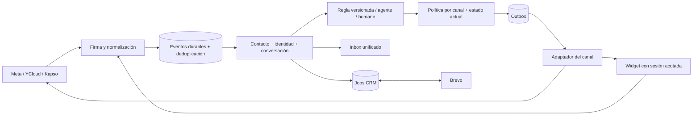

# TECH-SPEC — Omnichannel Pixiweb

Versión 1.0 · 2026-10-10 · **Diseño propuesto; ninguna migración aplicada**.

## Base y decisiones de arquitectura

Fork en commit `28a1530`. Conservar Next.js 16, React 19, TypeScript 5.7, Tailwind 3.4, shadcn/Radix, Supabase Auth/Postgres/Storage, Zod 4, Zustand 5 y AI SDK **6**. Las versiones exactas se toman del lockfile al construir; no instalar `latest` ni bajar AI SDK a v5 por la plantilla Forge.

El hosting del entorno operativo no fue comprobado. Mantener el despliegue compatible con Next actual. Usar primero el mecanismo existente de workers HTTP + pg_cron/pg_net con jobs persistidos; no incorporar Redis, microservicios ni un nuevo scheduler de pago como prerrequisito.

### Módulos propuestos

| Módulo | Responsabilidad |
|---|---|
| `src/features/channels/` | Conexiones, capacidades, política de envío, interfaces/adaptadores WA/Meta/Web |
| `src/features/contacts/` | Identidades por cuenta, vinculación verificada y preferencias |
| `src/features/inbox/` | Timeline, estados, buffer/agente, handoff y despacho compartidos |
| `src/features/automations/` | Editor, condiciones, versiones, pasos, simulación y ejecución |
| `src/features/crm/` | Interfaz CRM, Brevo, mapeos y conciliación; mantener contratos de HighLevel/HubSpot |
| `src/features/widget/` | Configuración, iframe, sesión visitante y endpoints acotados |
| `src/features/settings/` | UI de canales/CRM y permisos |
| `src/shared/` | Tokens/componentes, autorización y utilidades realmente comunes |

No mover todo el código existente al inicio. Extraer puntos de extensión con pruebas de regresión; mantener archivos nuevos debajo de 500 líneas y funciones pequeñas.

### Flujo de datos

## Contratos internos

**InboundEvent:** workspace resuelto en servidor, connectionId, providerEventId, kind, occurredAt, receivedAt, externalActorId, externalMessageId/commentId, content, mediaRefs y sourceContext permitido. El body remoto nunca elige el tenant. Conservar solo el payload mínimo y una copia diagnóstica protegida con retención.

**SourceContext:** channel, sourceType, assetId/postId/storyId/adId, referralRef y evidenceEventId opcionales. No deducir origen publicitario si el proveedor no lo entregó. Datos de campaña son contexto, no instrucciones para la IA.

**ChannelAdapter:** normalizeInbound, sendText, sendMedia, sendPrivateReply, replyPublicComment, fetchHistory y reconcileSend como capacidades opcionales explícitas. Resultado: accepted/externalId, rejected/errorCode o unknown. Un adapter no puede declarar una capacidad sin prueba de integración.

**SendPolicy:** recibe canal/cuenta, actor humano o automático, estado/revisión de conversación, mensaje/evento habilitante, consentimiento, capacidades y hora del servidor; devuelve allow/deny, reasonCode, validUntil y evidencia. Se evalúa al crear el job y otra vez inmediatamente antes del envío.

**CRMAdapter:** testConnection, upsertContact, listLists, create/updateList, add/removeMembership, listPipelines, create/updateDeal, associateContact, fetchChanges y reconcile. No asumir que todas las implementaciones pueden hacer todo. Mantener los contratos existentes hasta migrarlos.

## Modelo de datos y restricciones

Diccionario contractual para diseñar migraciones del fork, no SQL para ejecutar directamente sobre producción. Toda tabla pública de tenant lleva `workspace_id uuid NOT NULL`, `id uuid`, timestamps UTC, RLS y unicidad compuesta `(workspace_id,id)` si otra tabla la referencia. FKs entre entidades incluyen workspace para impedir mezclas incluso desde un worker privilegiado. Campos JSON contienen datos validados/versionados, nunca secretos públicos.

| Tabla | Columnas nuevas/principales y claves |
|---|---|
| `contacts` existente | Permitir `phone text NULL`; mantener normalización y unicidad del teléfono no nulo por workspace; nombre/email opcionales, preferencias actuales intactas. Añadir revisión optimista si no existe |
| `channel_connections` | channel enum WA/IG/Messenger/Web, provider text, external_account_id text, display_name, status, capabilities jsonb, settings jsonb, credentials_ref uuid, last_verified_at, revoked_at. Unique workspace/channel/provider/account; índice de routing global de activo con exclusividad de tenant activo |
| `private.channel_credentials` | connection_id uuid, workspace_id, encrypted_payload text, key_version, expires_at. Sin acceso anon/authenticated, sin Realtime; cifrado con AAD workspace+provider+connection |
| `contact_identities` | contact_id uuid, connection_id uuid, external_user_id text, kind, verified_at, metadata mínima. Unique workspace/connection/external_user_id; no unique global por username |
| `conversations` existente | connection_id uuid, identity_id uuid, channel enum ampliado, state_revision bigint, source_context jsonb, last_eligible_inbound_at, policy_context jsonb. Unique workspace/connection/identity para conversación persistente; mantener IDs/historial y estados actuales |
| `messages` existente | connection_id, external_message_id text, provider text, delivery_state, policy_evidence jsonb, operation_id uuid. Unique workspace/connection/external_message_id donde no nulo; conservar wamid durante transición |
| `channel_events` | connection_id, event_key text, event_kind, occurred_at, received_at, payload_min jsonb, processing_status, expires_at. Unique workspace/connection/event_key; índice de pendientes/retención |
| `social_comments` | connection_id, external_comment_id, external_actor_id, media_id, media_kind, text mínimo, occurred_at, eligibility_until. Unique workspace/connection/external_comment_id |
| `private_reply_claims` | connection_id, external_comment_id, automation_run_id, message_operation_id, status, claimed_at. Unique workspace/connection/external_comment_id; las reglas compiten por esta reserva, no envían cada una |
| `message_jobs` | operation_id unique, connection_id, conversation_id opcional para primer private reply, event_id, action, payload, state, expected_state_revision, run_after, attempts, lease_owner, lease_until, result_external_id, last_error_code. Unique idempotency_key; índice state/run_after |
| `automation_rules` existente | scope canal/cuenta/fuente, priority, status, active_version_id; conservar compatibilidad de reglas v1 y permisos |
| `automation_rule_versions` | rule_id, version int, condition_schema_version, conditions jsonb, steps jsonb, created_by. Unique workspace/rule/version; versiones publicadas inmutables |
| `automation_runs` existente/ampliada | rule_version_id, event_id, conversation_id nullable, state, matched_reason, step_results, policy_result, started_at, finished_at. Unique workspace/rule_version/event |
| `widget_sites` | connection_id, public_site_id aleatorio unique, allowed_origins text[], public_config jsonb, enabled, retention_days; no credenciales CRM ni datos de contactos |
| `widget_sessions` | site_id, identity_id, conversation_id, token_hash, expires_at, revoked_at, verified_subject opcional. Revocación efectiva; token sin datos personales |
| `crm_connections` | integración existente o referencia equivalente, workspace, provider, account_fingerprint, active, status, config sin secretos. Un solo CRM activo por workspace |
| `crm_links` | crm_connection_id, entity_type, local_entity_id, remote_id, remote_version, last_common_hash, last_synced_at, tombstoned_at. Unique conexión/tipo/local y conexión/tipo/remote |
| `crm_lists` + `crm_memberships` | catálogo local: nombre, remote_list_id, managed; relación contacto/lista unique, origen y revisión. El catálogo mapeado es distinto de etiquetas arbitrarias |
| `crm_deals` | crm_connection_id, remote_deal_id, contact_id, name, pipeline_id, stage_id, amount numeric nullable, currency text nullable, attributes jsonb, revision. Índices de pipeline/contacto; importe cero distinto de desconocido |
| `crm_sync_jobs` | direction, entity_type, entity_id, operation_id, origin, expected_revision, payload_hash, state, retry_at, attempts, lease_until, error_code. Índice de vencidos; estados unknown/conflict |
| `crm_sync_conflicts` | entity/link, base snapshot/hash, cambios local/remoto, fields, resolved_by, resolution, resolved_at. Solo roles habilitados resuelven |
| `integration_audit_events` | actor, connection, action, outcome, correlation_id, timestamp, datos mínimos sin token/body completo |

Entidades auxiliares (listas, oportunidades, conflicto) son necesarias para mostrar y editar los objetos bidireccionales; no crean un CRM comercial adicional ni un Kanban.

**Aislamiento:** canal/activo activo pertenece a un solo workspace por app/proveedor. Un operador de agencia cambia de workspace; no duplica una misma Página en dos tenants. Transferir activo es una operación administrativa explícita con pausa y auditoría. Filtros de UI no reemplazan RLS.

**Identidad:** persona y conversación son distintas. Puede haber varias conversaciones de una persona en distintos canales/cuentas. Vinculación solo con prueba o decisión autorizada dentro del workspace. Sin email/teléfono no inventar valores. Borrar o desvincular no expone mensajes de otra identidad.

### Migración expandir → migrar → activar

1. Capturar baseline, backup restaurable y conteos/hash de conversaciones/mensajes, en entorno aislado. Inventariar TODAS las migraciones actuales; la guarda vigente está en `20260927000001_whatsapp_provider_per_workspace.sql`.
2. Crear tablas/columnas aditivas/RLS con flags apagados; ampliar enum en transacción separada si Postgres requiere commit antes de usar valores.
3. Crear conexiones WA desde integraciones activas. Backfill identities desde phone normalizado y conexiones; preservar IDs de conversación, wamid y relaciones. Detectar colisiones/múltiples proveedores antes de cambiar unicidad.
4. Rellenar connection_id/identity_id en lotes reanudables; validar conteos y FKs. Índices únicos primero con reporte de colisiones, nunca borrar duplicados para que pase.
5. Adaptar lectores/escritores WA, dual-read transitorio donde haga falta, cubrir coexistencia/ecos, template guard, notas y supresiones.
6. Reemplazar guardas de envío por política de canal, retirar unicidad antigua solo cuando los nuevos escritores estén activos. Permitir phone nulo después de actualizar todas las validaciones/formularios.
7. Activar nuevo canal por workspace. Rollback operativo: apagar entradas/reglas/envíos de ese canal y seguir WA, conservar tablas e historial. No deshacer migraciones destruyendo datos nuevos.

Nombres reservados para futuras migraciones (a crear y validar en /build): `20261010000001_omnichannel_expand.sql`, `20261010000002_omnichannel_backfill.sql`, `20261010000003_omnichannel_constraints.sql`, `20261010000004_automation_jobs.sql`, `20261010000005_widget_sessions.sql`, `20261010000006_brevo_sync.sql`. Verificar conflictos de timestamps al construir. No existen por haberlas nombrado aquí.

## Meta: onboarding y envío

Una app del SaaS, Facebook Login for Business por cliente, Página + Instagram Business/Creator vinculado. No cuentas personales. IG Login sin Página es alternativa futura; no mezclar scopes. Fijar versión Graph desde el App Dashboard en F1; no inventar versión en este documento.

Scopes candidatos: pages_show_list, pages_manage_metadata, pages_messaging, pages_read_engagement, instagram_basic, instagram_manage_messages, instagram_manage_comments. Evaluar pages_read_user_content/pages_manage_engagement para comentarios y respuestas públicas. Solo agregar ads_read/ads_management donde el endpoint/rol realmente lo exija.

OAuth state de un solo uso, TTL, ligado a usuario/workspace/rol y redirect registrado; callback vuelve a comprobar rol. Mostrar selector de activos y permisos, suscribir cada activo después de validar titularidad, persistir cifrado y probar recepción. `connected` no equivale a `ready`: estados connecting, needs_permissions, awaiting_webhook, ready, degraded, revoked.

Webhook: challenge con verify token del servidor; POST con firma HMAC SHA-256 sobre bytes originales usando app secret, comparación constante. Resolver connection desde activo, validar esquema/tamaño y guardar evento duradero antes de ACK. Evento desconocido se registra sin ejecutar acciones.

| Caso | Política |
|---|---|
| WA | Adaptador mantiene proveedor activo, ventanas, templates/opt-in y supresión actuales; no crear excepción nueva por rediseño |
| IG/Messenger DM habitual | Respuesta dentro de ventana estándar aplicable, normalmente 24h desde inbound habilitante; comentario público no la abre |
| IG/Messenger private reply | Una respuesta inicial por comentario elegible, hasta 7 días según endpoint; validar FB vigente en spike; Live fuera |
| Seguimiento de private reply | Solo luego de respuesta del destinatario que habilita mensajería; el primer private reply no dispara secuencia ni agente |
| Anuncio Click-to-Instagram Direct | Documentación IG actual describe hasta 7 días para primera interacción elegible; flag apagado hasta probar criterios/payload/version; registrar evidencia y validUntil |
| Human Agent | Extensión solo si acceso vigente y envío manual humano; nunca usar para IA o automatización |
| Web | Sin ventana Meta; sujeto a sesión, preferencias, abuso y estado humano/IA propios |

Errores no sorteables: expiry, revoked, permission_missing, identity_unknown, opted_out, human_hold, duplicate_private_reply, unsupported_capability. Un admin no puede forzar una prohibición de Meta. Los media/CDN URLs pueden expirar; validar permisos y renovar referencias, no suponer permanencia del enlace. Descargas solo desde hosts autorizados, sin URLs privadas/loopback ni HTML activo.

## Automatizaciones y fiabilidad

Editor de reglas con canal → cuenta → fuente → activo/post → palabra/condiciones → pasos → prueba → activar. Mantener v1; traducir sus triggers/acciones conservando semántica. No habilitar triggers históricos que el código no ejecuta.

Keywords: NFKC, trim, casefold; opción explícita de equivalencia de tildes; palabras completas o frase según selección; sin regex arbitraria inicial. Excluir comentarios propios, borrados/no elegibles y eventos históricos importados. Una regla ganadora por prioridad determinista; si hay empate, orden estable visible.

Pasos iniciales: private reply, respuesta pública opcional, etiqueta, asignación, handoff y operación CRM. Send text solo para evento/canal habilitante. Registrar éxito/error por paso: una falla CRM no repite un DM entregado. Draft, active, paused y archived con versiones; pausar cancela jobs pendientes, no mensajes ya enviados.

Jobs con dedup única, adquisición transaccional (`FOR UPDATE SKIP LOCKED`), lease y fencing/revisión de conversación. El humano toma conversación → invalida trabajo IA pendiente. Revalidar luego de generar texto y antes de enviar. Webhook duplicado, eco outbound o receipt no invocan de nuevo la IA.

Implementación F3, incremento 10: contexto de respuesta por batch en private.ai_reply_preparations, separado de meta modificable del buffer. prepare_ai_channel_reply fija modo, revisión, conexión, identidad y evento vinculado a una entrada del batch; enqueue_ai_channel_reply conserva texto y crea un job estable con operación=batch_id. Revalida evidencia y control; un reintento recupera el mismo job incluso terminal/unknown. RPCs invoker sólo service_role, sin nuevo acceso del navegador. CHANNEL_AI_WORKSPACES tiene límite de tres workspaces y exige también ingress/worker para enqueue. Contrato probado; no está conectado al buffer ni habilita generación/envío. Handoff y herramientas con salidas propias deben adaptarse antes del rollout.

No se garantiza exactly-once entre DB y proveedor remoto. Timeout/crash después del POST puede ser envío confirmado remotamente: marcar unknown, intentar correlacionar por ID/eco/capacidad documentada; si no se puede, revisión manual. Nunca reenviar a ciegas una guía o crear otra oportunidad.

ACK después de persistir; dispatch inmediato acotado con jobs durables y recuperación por cron. No usar tareas fire-and-forget después de devolver HTTP. Con solo cron cada minuto no prometer entrega en segundos. Backoff exponencial+jitter, Retry-After, cuotas por app/cuenta/tenant, DLQ y límite de intentos/edad. Historial importado se marca histórico y no ejecuta reglas.

## Brevo bidireccional

API key por workspace con privilegios mínimos disponibles y cifrado; autenticación pública OAuth multi-cliente no se asume disponible: la documentación vigente describe apps privadas. Probar `GET /v3/account`, detectar cuenta ya conectada y mapearla. Cambio de cuenta invalida jobs/mapeos viejos, no reasigna sus IDs a la cuenta nueva.

- Contactos: stable ext_id namespace workspace+contact; GET/lookup y crm_link antes de crear. Preferir update id conocido; no usar forceMerge. email/SMS solo reales. Atributos deben existir; validar tipos y nombre uppercase cuando lo exija Brevo.
- Listas: importar catálogo y seleccionar listas administradas; crear/renombrar desde SaaS es acción explícita. Membresías se agregan/quitan por deltas, sin reemplazar listas ajenas. Eventos no cubiertos → reconciliar catálogo y miembros paginados.
- Oportunidades: catálogo de pipelines/etapas remoto, asociación a contactos vía IDs; importe/moneda opcionales reales. Crear una vez por operación; cambios locales/externos reflejados. No usar el nombre como identidad ni asumir unicidad.
- Webhooks: contactos/listas usando autenticación/headers soportados; Sales CRM posee guía propia, verificar alta disponible en la cuenta. No enviar un inventado `type:sales` al endpoint genérico.
- Cuando no haya webhook de un cambio, reconciliación eventual y visible. Presupuesto por familia de endpoint, caché de catálogos, cursores y polling adaptativo; el límite general de otros endpoints puede ser 100/h.
- Imports iniciales: listas y pipeline seleccionados, previsualización de alcance; no copiar automáticamente toda la base de un cliente. Reconciliar las entidades administradas y explicitar cobertura.

| Campo/operación | Autoridad y conflictos |
|---|---|
| ID local / identidad de canal | SaaS; Brevo nunca cambia la pertenencia tenant/canal |
| Nombre, email, teléfono, atributos mapeados | Merge de campos distintos desde último snapshot común; mismo campo cambiado en ambos → conflicto visible, sin decidir por reloj remoto |
| Preferencias/supresión | Prevalece la opción más restrictiva; consentimiento y evidencia por canal, no equivalencia email=WA |
| Pipeline/etapa, importe/moneda | Catálogo Brevo; cambios explícitos de cualquier lado pasan por revisión/base común y conflicto si simultáneos |
| Lista/membresía administrada | Cambios bidireccionales por revisión/delta; eliminación concurrente conserva baja hasta resolución |
| Eliminación | Tombstone + detener sync; no recrear ni borrar automáticamente todo el historial remoto/local |

Prevención de loops: origin + operation_id + base revision/hash; un eco de nuestros cambios actualiza confirmación, no inicia nueva operación. No depender de que Brevo preserve headers de idempotencia no documentados.

Crashes de creación de deal: correlacionar mediante mapeo y marcador externo si la cuenta admite atributo dedicado; validar esto en F1. Sin identificador recuperable, unknown/revisión antes de cualquier retry. Webhook es señal, recuperar estado remoto autenticado para verificar datos sensibles; payloads grandes y replays se deduplican.

## Widget y API de aplicación

Loader versionado monta iframe del SaaS con sitio público; no inyecta scripts de terceros. Allowlist de orígenes exactos (scheme/host/port), CSP frame-ancestors, CORS sin wildcard y postMessage validando origin/source/esquema. La allowlist del navegador no autentica a un atacante de servidor: añadir cuotas, TTL y protección de abuso.

Visitante anónimo con token aleatorio/firmado limitado a site/session/conversation y revocable. Persistencia primera parte a través del loader y protocolo acotado; no depender de cookies de terceros. Token en memoria/almacenamiento minimizado, nunca URL/log. No recuperar mensajes históricos por email ingresado. Verificación posterior no mezcla conversaciones sin autorización.

Visitante accede únicamente por gateway server-side; no suscripción general a Realtime ni service-role en cliente. Entrega SSE cuando el hosting lo permita, con fallback polling mediante cursor y token acotado. Operadores conservan Realtime bajo RLS. Sanitizar texto/links, tamaño máximo y adjuntos con capability off hasta validación.

| Endpoint propuesto | Autorización/contrato |
|---|---|
| `/api/workspace/[id]/channels` GET/POST/PATCH | Sesión+membership; admin configura; manager si permiso explícito; schema Zod y secreto write-only |
| `/api/integrations/meta/start`, `callback` | Sesión/state/rol; selección de activos; no workspace confiado desde query |
| `/api/webhooks/meta` GET/POST | Challenge/firma; activo resuelto por servidor |
| `/api/webhooks/brevo/[connectionToken]` POST | Identificador opaco distinto del secreto + auth configurada; leer estado remoto; no tenant en body |
| `/api/widget/bootstrap`, `messages`, `events` | site + origen + sesión; enviar/leer solo conversación propia; límites por sitio/sesión |
| `/api/conversations/[id]/messages` existente | Sesión+workspace+rol y política de canal; idempotencyKey requerido |
| `/api/workspace/[id]/automations/simulate` | Sin efectos externos; fixture/snapshot, salida de pasos y política |
| `/api/workspace/[id]/crm/sync`, `conflicts` | Roles explícitos; retry no crea duplicados; resolver con expectedRevision |
| `/api/internal/channels/process`, `crm/process` | Secreto interno server-only, lotes acotados y lease; nunca endpoint público sin auth |

Roles: admin conecta/desconecta y gestiona permisos; manager configura reglas y CRM según grants del workspace; agent responde/toma/asigna dentro de permisos actuales y puede editar campos autorizados; viewer solo lectura. Toda mutación vuelve a validar, no depende de esconder botones. Operaciones de CRM con impacto quedan auditadas.

### Configuración propuesta (nombres, nunca valores)

`META_APP_ID`, `META_APP_SECRET`, `META_WEBHOOK_VERIFY_TOKEN`, `META_GRAPH_API_VERSION`, `META_REDIRECT_URI`, `WIDGET_SIGNING_SECRET`, `WIDGET_PUBLIC_BASE_URL`. Reutilizar las variables vigentes de URL/Supabase/cifrado/cron después de inventariar `.env.local.example`; no duplicar claves de cifrado. Brevo api-key y secreto webhook son POR WORKSPACE cifrados, no una única `NEXT_PUBLIC_BREVO_KEY`. No variable secreta con NEXT_PUBLIC.

Servicios: Meta, YCloud/Kapso existentes, Brevo del cliente, Supabase, hosting y modelo IA existentes. Costos dependen de planes/volumen; no se verificaron facturas, cuotas comerciales ni un presupuesto. No habilitar facturación.

## Validación, observabilidad y operación

Pruebas de contrato con fixtures oficiales anonimizados; unit tests de políticas/dedup/conflictos; migración en copia con dos tenants; E2E de operador/visitante; sandbox real Meta/Brevo para cada capacidad publicada. Simulador y mocks no prueban aprobación ni delivery real.

Medir ACK p95, edad de job más viejo, respuesta permitida/bloqueada/unknown, fallas y cuota por conexión, lag CRM, conflictos, handoffs, consumo IA y reconexiones. IDs de correlación en UI/log; no guardar secretos/texto completo por defecto.

Objetivos técnicos de piloto propuestos, a medir: ACK duradero p95 <2s bajo carga acordada; cero cruces de tenant; cero reenvíos automáticos tras unknown; jobs recuperables ante reinicio; lag CRM dentro del presupuesto configurado. Latencia de keyword y concurrencia se fijan con el spike/carga real; no se ofrece SLA comercial.

Revocación desconecta cuenta, cancela jobs futuros y mantiene historial conforme retención; atención por otros canales sigue. Callback de eliminación y procesos de exportación/borrado se revisan con políticas del producto antes del lanzamiento. URLs de privacidad y condiciones deben pertenecer al SaaS; el rediseño no copia promesas legales/comerciales de Pixiweb.

Fuentes y límites vigentes: [relevamiento](docs/investigacion/RELEVAMIENTO-omnichannel-pixiweb.md). Fijar contratos/versiones en F1 antes de implementar contra un proveedor.

